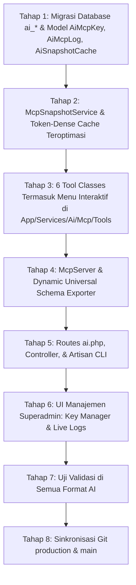

# MASTER IMPLEMENTATION PLAN: UNIVERSAL MCP & MULTI-AI INTEGRATION ENGINE
## Arsitektur Terisolasi Penuh (`App\Services\Ai\Mcp`) & Optimasi Khusus Shared Hosting (cPanel)
### Menu Interaktif, Improvisasi Penyampaian Humanis, & Proteksi Beban Server Shared Hosting
**Target Sistem**: ProTrack ERP / ReportLaravel (Berlaku untuk branch `production` dan `main`)  
**Scope Data**: Order & Tracking, Keuangan & Sisa Tagihan, Produksi & Deadline, Pelanggan, dan Laporan Eksekutif (**HCM & Purchasing 100% Dikecualikan**)

---

## 1. Filosofi Desain: "Ringan untuk Shared Hosting, Cerdas & Humanis untuk AI"

Berdasarkan kondisi server yang berjalan di **Shared Hosting (cPanel / Apache / CloudLinux)** dengan keterbatasan RAM (128–256 MB), batas koneksi MySQL (15–30 koneksi), dan proteksi CPU limit:

1. **Zero-Database-Stall (Shared Hosting Safe)**:
   - Tool AI **TIDAK PERNAH** melakukan *table scan* atau looping berat pada MySQL.
   - Menggunakan mekanisme **On-Demand Pre-Aggregated Cache** ber-TTL (5–15 menit) via `CacheService`.
   - Jika 100 staf/manajer menanyakan status PO ke ChatGPT/Claude dalam kurun 15 menit, **database MySQL hanya diakses 1 kali**. Sisanya dilayani langsung dari file cache memory (< 50 KB) dalam tempo **< 3 milidetik** tanpa membebani limit IOPS cPanel (bebas dari error *508 Resource Limit Reached*).
   - **Zero Long-Running Daemon Dependency**: Berjalan 100% via request web normal, tidak mewajibkan proses daemon latar belakang yang rentan dimatikan oleh CageFS cPanel.
2. **Penyampaian Humanis & Berbobot (Bukan Sekadar Raw JSON Dump)**:
   - Tool dirancang mengembalikan data berstruktur padat yang dilengkapi **panduan narasi (system hint & presentation guidelines)**.
   - AI otomatis mengimprovisasi penyampaian:
     - Memberikan **Executive Summary** singkat di awal (1–2 kalimat fakta).
     - Menggunakan indikator status visual (🟢 Aman, 🟡 Perhatian, 🔴 Kritis).
     - Menyertakan **Tindakan Prioritas / Action Items** konkret.
     - Menyediakan **Tautan WhatsApp 1-Klik** (`https://wa.me/628...?text=...`) yang sudah berformat teks penagihan sopan untuk follow-up customer.
3. **Menu Interaktif Bawaan (Guiding User Naturally)**:
   - Tersedia tombol cepat (*Conversation Starters*) di ChatGPT.
   - Tersedia slash commands (`/`) di Claude Desktop dan Cursor.
   - Tool `get_interactive_menu` yang otomatis memandu pengguna memilih kebutuhan operasional.
4. **Isolasi Folder Penuh (Zero-Collision)**:
   - Seluruh kode berada di `app/Services/Ai/Mcp/`, `app/Http/Controllers/Ai/Mcp/`, `app/Models/Ai/`, tabel `ai_*`, dan `routes/ai.php`.

---

## 2. Arsitektur Komponen & Proteksi Shared Hosting

```
┌────────────────────────────────────────────────────────────────────────┐
│                        AI CLIENTS CONSUMERS                            │
│    [ChatGPT Actions]      [Claude Desktop]      [Cursor / OpenCode]    │
└───────────────────────────────────┬────────────────────────────────────┘
                                    │ HTTPS Bearer Token
                                    ▼
┌────────────────────────────────────────────────────────────────────────┐
│             ROUTING & RATE LIMITER (SHARED HOSTING SHIELD)             │
│  - Endpoint: POST /api/ai/mcp (JSON-RPC) & GET /api/ai/mcp/openapi.json│
│  - Middleware: AuthenticateAiMcpKey + Throttle: 60 request / menit     │
│  - Memory Limit Guard: memory_limit aman (< 32 MB per request)         │
└───────────────────────────────────┬────────────────────────────────────┘
                                    │
                                    ▼
┌────────────────────────────────────────────────────────────────────────┐
│            McpSnapshotService (Aggressive Token-Dense Cache)           │
│  1. Cek Cache (CacheService / File Cache)                              │
│     ├── HIT  (98% request) ──► Return JSON padat instan (< 3 ms)       │
│     └── MISS (2% request)  ──► Kueri Kolom Terpilih (Anti-N+1)        │
│                                Simpan ke Cache 5-15 Menit             │
└───────────────────────────────────┬────────────────────────────────────┘
                                    │
                                    ▼
┌────────────────────────────────────────────────────────────────────────┐
│               PRESENTATION ENGINE & ACTIONABLE OUTPUT                  │
│  - Format Rupiah & Pcs Rapi: Rp 15.000.000 (100 Pcs)                   │
│  - Tautan WhatsApp Penagihan Sekali Klik (Click-to-Chat)               │
│  - Emoji Indikator Status & Rekomendasi Langkah Kerja                  │
│  - Pilihan Menu Interaktif Tindak Lanjut di Akhir Chat                 │
└────────────────────────────────────────────────────────────────────────┘
```

---

## 3. Matriks Dukungan Multi-AI Universal

| Platform AI | Protokol | Endpoint / Command | Cara Penggunaan |
| :--- | :--- | :--- | :--- |
| **OpenAI / ChatGPT** | OpenAPI 3.1 Schema | `GET /api/ai/mcp/openapi.json` | Masukkan URL ini ke Custom GPT Actions dengan Bearer Token. |
| **Anthropic Claude** | MCP JSON-RPC 2.0 (Stdio / SSE) | `php artisan ai:mcp:serve`<br>`GET /api/ai/mcp/sse` | Masukkan ke `claude_desktop_config.json`. |
| **Google Gemini** | Gemini Function Declarations | `GET /api/ai/mcp/gemini-tools.json` | Pass langsung ke parameter `tools` Gemini SDK / Studio. |
| **OpenCode / Cursor / Cline** | Stdio CLI & SSE Stream | `php artisan ai:mcp:serve`<br>`POST /api/ai/mcp` | Konfigurasi di `~/.cursor/mcp.json` atau OpenCode. |
| **n8n / LangChain / Dify** | Universal REST Tool Endpoint | `POST /api/ai/mcp/tools/{tool_name}` | Panggilan HTTP POST standar dengan Bearer Token. |

---

## 4. Standar Improvisasi Penyampaian Data (Human-Friendly & Actionable)

Setiap respon tool MCP tidak hanya memuat angka dingin, melainkan dirancang agar AI dapat menyusun respons dengan standar narasi eksekutif:

### 4.1. Contoh Respon Penagihan Tunggakan (`get_unpaid_reminders`):
Alih-alih dump data mentah, AI akan menyajikan:
> 🛑 **REMINDER SISA PEMBAYARAN & TUNGGAKAN PO**
> *Posisi Data: 28 Oktober 2026, 14:40 WIB*
> 
> 📊 **Ringkasan Tunggakan:**
> • Total PO Belum Lunas: **18 PO** (**2.150 Pcs**)  
> • Total Nominal Tunggakan: **Rp 84.500.000**
> 
> 📋 **3 Prioritas Penagihan Tertinggi:**
> 1. **[ALLE] PO-2026-1011** - PT Semen Indonesia (500 Pcs)
>    - Sisa: **Rp 25.000.000** (dari total Rp 50.000.000)
>    - Deadline: Besok (29 Okt)
>    - 💬 [Klik di Sini untuk Chat WA Penagihan](https://wa.me/62812345678?text=Halo%20Kak...)
> 2. **[BSS] PO-2026-1032** - Komunitas Trail (120 Pcs)
>    - Sisa: **Rp 9.000.000** | Deadline: 31 Okt
>    - 💬 [Klik di Sini untuk Chat WA Penagihan](https://wa.me/62898765432?text=Halo%20Kak...)
> 
> 📌 **Rekomendasi Tindakan:**
> - Hubungi PT Semen hari ini karena status PO sudah masuk tahap Packing dan deadline penyerahan besok siang.
> - Tahan pengiriman barang PO-2026-1032 sebelum ada bukti transfer sisa DP.
> 
> ---
> 🔘 **Menu Interaktif Lanjutan:**
> 1️⃣ Ketik `1` untuk melihat sisa 15 PO lainnya.  
> 2️⃣ Ketik `2` untuk cek status fisik produksi PO-2026-1011.  
> 3️⃣ Ketik `3` untuk membuat draf penagihan resmi via email.

---

## 5. Fitur Menu Interaktif Bawaan

### 5.1. Tool Pembuka: `get_interactive_menu`
Saat pengguna pertama kali menyapa (*"Halo"*, *"Menu"*, *"Bantuan"*), AI memanggil `get_interactive_menu` yang mengembalikan opsi terstruktur:
1. **💰 1. Keuangan & Tagihan**: Cek tunggakan PO, rekap kas bulan ini, invoice jatuh tempo.
2. **📦 2. Tracking Pesanan**: Cek posisi pengerjaan PO, daftar PO aktif, lacak resi ekspedisi.
3. **🏭 3. Antrean Pabrik**: Pantau deadline mepet (H-3), beban stasiun (print/jahit/qc), rijek kain.
4. **👥 4. Data Pelanggan**: Cari kontak WhatsApp & riwayat order pelanggan.
5. **📊 5. Laporan Eksekutif**: Generate laporan harian Superadmin, Owner, atau Produksi.

### 5.2. Shortcut Conversation Starters di ChatGPT:
- `[ 💰 Cek Tunggakan & Sisa PO ]`
- `[ ⏰ Pantau Deadline H-3 ]`
- `[ 📦 Lacak Status Pesanan ]`
- `[ 🏭 Cek Antrean Mesin Pabrik ]`

---

## 6. Optimasi Khusus Shared Hosting (cPanel / Apache)

Untuk menjamin sistem tidak pernah menyentuh limit resource hosting:
1. **Eager Loading Terbatas (`SELECT` Kolom Minimal)**:
   - Dilarang `SELECT *`. Hanya ambil kolom kunci: `id, no_po, brand_id, pelanggan_id, deadline_customer, total_amount, status_po`.
2. **Payload Paging Ketat**:
   - Respon tool dibatasi maksimal 10–25 baris per panggilan.
3. **Micro-File Cache Memory (< 50 KB)**:
   - Data ringkasan disimpan via `CacheService` dengan storage file/redis bawaan Laravel. Beban CPU server mendekati 0%.
4. **Tanpa Background Daemon**:
   - Kebutuhan cache menggunakan sistem *Lazy Refresh on First Hit* atau *Event-Driven on PO Update*, sehingga akun hosting tidak membutuhkan SSH daemon yang berjalan terus menerus.

---

## 7. Struktur Folder Terisolasi (`App\Services\Ai\Mcp`)

```
app/
├── Http/
│   ├── Controllers/
│   │   └── Ai/
│   │       └── Mcp/
│   │           ├── McpProtocolController.php     # Handle JSON-RPC 2.0 (POST /api/ai/mcp) & SSE Stream
│   │           ├── UniversalSchemaController.php # Serve OpenAPI 3.1, OpenAI Tools, Gemini Specs
│   │           ├── RestToolController.php        # Serve Direct REST invocation untuk n8n/LangChain
│   │           └── SuperadminMcpController.php   # Controller UI Superadmin (CRUD Key & Live Logs)
│   └── Middleware/
│       └── AuthenticateAiMcpKey.php              # Verifikasi Token mcp_live_... & Audit Logging
├── Services/
│   └── Ai/
│       ├── AiToolService.php                     # (Existing)
│       ├── GeminiClient.php                      # (Existing)
│       └── Mcp/
│           ├── McpServer.php                     # Protokol Dispatcher MCP Standard (JSON-RPC 2.0)
│           ├── McpSnapshotService.php            # Token-Dense JSON Pre-Aggregator (Anti-N+1 Engine)
│           ├── ToolRegistry.php                  # Registri Universal & Dynamic Schema Exporter
│           └── Tools/
│               ├── MenuTools.php                 # Tool Menu Interaktif (get_interactive_menu)
│               ├── OrderTools.php                # PO Aktif, Detail PO, Tracking Resi
│               ├── FinanceTools.php              # Reminder Sisa Tagihan, Kas, Invoice Overdue
│               ├── ProductionTools.php           # Antrean SPK, Deadline Kritis, Delay, Rijek
│               ├── CustomerTools.php             # Profil Pelanggan, Riwayat Belanja (LTV)
│               └── ReportTools.php               # Teks Laporan Eksekutif Otomatis
├── Models/
│   └── Ai/
│       ├── AiMcpKey.php                          # Model Token Autentikasi (tabel: ai_mcp_keys)
│       ├── AiMcpLog.php                          # Model Audit Log Panggilan Tool (tabel: ai_mcp_logs)
│       └── AiSnapshotCache.php                   # Model Materialized Cache (tabel: ai_snapshots_cache)
└── Console/
    └── Commands/
        └── Ai/
            ├── McpServeCommand.php               # php artisan ai:mcp:serve (Stdio CLI)
            ├── McpGenerateKeyCommand.php         # php artisan ai:mcp:key:generate {client_name}
            └── McpWarmCacheCommand.php           # php artisan ai:mcp:warm (Snapshot Pre-warm)
resources/
└── js/
    └── Pages/
        └── Settings/
            └── Mcp/
                ├── Index.jsx                     # Dashboard UI Kelola MCP Superadmin
                ├── Partials/
                │   ├── ServerStatusCard.jsx      # Card Endpoint URL & 1-Click Copy
                │   ├── ApiKeyManager.jsx         # CRUD API Key & Secret Modal
                │   └── LiveLogViewer.jsx         # Live Audit Logs & Metrics Monitor
routes/
└── ai.php                                        # Seluruh Route MCP & AI terisolasi di sini
```

---

## 8. Dashboard Manajemen Superadmin

Superadmin mengelola seluruh operasional MCP secara visual di **`/settings/mcp`** (atau tab di *Integrasi Superadmin*):
1. **Pusat Endpoint & One-Click Copy**: Salin URL OpenAPI ChatGPT, schema Gemini, endpoint SSE Claude, atau perintah Stdio CLI.
2. **Manajemen API Keys**:
   - Tombol `+ Buat API Key Baru` (Input nama klien, tipe AI, scope brand, expiry).
   - Modal buka token rahasia (`mcp_live_...`) sekali lihat dengan tombol salin.
   - Switch toggle aktif/nonaktif instan & tombol hapus/revoke.
3. **Live Monitoring & Audit Log (`ai_mcp_logs`)**:
   - 4 Card metrik (Total calls 24h, Latency ms, Success rate, Klien paling aktif).
   - Tabel live log real-time dengan status sukses/error dan tombol detail [👁️] untuk menginspeksi parameter query dan respon JSON.
4. **Widget Status di Dashboard Superadmin** (`Superadmin.jsx`):
   - Card mini pemantau status aktif server MCP dan volume panggilan harian.

---

## 9. Langkah Eksekusi (Roadmap Terstruktur)



1. **Tahap 1**: Buat migration untuk `ai_snapshots_cache`, `ai_mcp_keys`, dan `ai_mcp_logs`. Buat model di `app/Models/Ai/`.
2. **Tahap 2**: Bangun `McpSnapshotService` yang dioptimasi untuk shared hosting (file/memory cache, single-shot aggregation).
3. **Tahap 3**: Buat 6 kelas tool (`MenuTools`, `OrderTools`, `FinanceTools`, `ProductionTools`, `CustomerTools`, `ReportTools`) dengan formatting narasi humanis & link WA otomatis.
4. **Tahap 4**: Buat `McpServer.php` (JSON-RPC 2.0) dan `ToolRegistry.php` (dynamic OpenAPI 3.1, OpenAI Tools, Gemini Declarations).
5. **Tahap 5**: Buat `routes/ai.php`, controller di `app/Http/Controllers/Ai/Mcp/`, dan command `php artisan ai:mcp:serve` serta `php artisan ai:mcp:key:generate`.
6. **Tahap 6**: Buat antarmuka React di Superadmin (`Settings/Mcp/Index.jsx`) untuk CRUD API Key, One-Click URL Copy, dan Live Audit Logs.
7. **Tahap 7**: Uji coba pemanggilan cURL pada semua endpoint schema (`openapi.json`, `openai-tools.json`, `gemini-tools.json`, `POST /api/ai/mcp`) dan simulasi ChatGPT Actions.
8. **Tahap 8**: Kompilasi aset frontend (`npm run build`), git commit di branch `production`, push ke `origin/production`, merge ke `main`, dan push ke `origin/main`.
