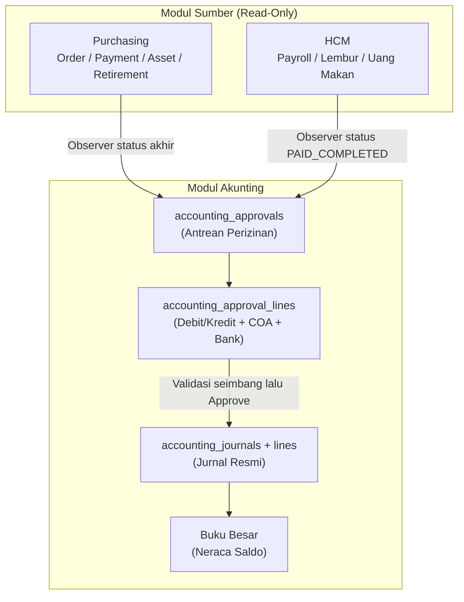

# Rencana Pengembangan Modul Akunting (Accounting) NISGroup
## Blueprint Teknis, Arsitektur Data, Alur Perizinan (Approval), Jurnal Harian & Buku Besar

Dokumen ini merupakan perencanaan teknis, arsitektur data, logika perizinan, dan skema implementasi untuk modul **Akunting (Accounting)** pada platform NISReport.

Modul Akunting adalah lapisan pembukuan resmi perusahaan. Posisinya bukan menggantikan modul keuangan lama, melainkan berdiri sebagai modul baru yang menjadi **gerbang perizinan (approval) pembukuan** untuk seluruh transaksi yang lahir dari modul **Purchasing** dan modul **HCM / Payroll**. Setiap transaksi Purchasing dan HCM yang menyentuh kas, bank, utang, beban, atau aset wajib memperoleh jurnal akuntansi di modul Akunting.

> Catatan tentang modul keuangan lama (`pemasukan`, `pengeluaran`, `kategori_pemasukan`, `kategori_pengeluaran`): modul tersebut dikesampingkan dan tidak disentuh. Modul Akunting dibangun mandiri dengan tabel, model, controller, service, dan route sendiri.

---

## 1. Latar Belakang & Ruang Lingkup

### A. Masalah yang Diselesaikan
Saat ini Purchasing dan HCM sudah memiliki alur kerja operasional (pesan barang, bayar vendor, register aset, hitung payroll, lembur, uang makan). Yang belum ada adalah pencatatan pembukuan resmi yang:
1. Mengikat setiap pengeluaran/penerimaan ke **perusahaan** dan **akun bank** yang benar.
2. Mengelompokkan transaksi ke **akun COA** berdasarkan kelompok debit/kredit.
3. Menyediakan **jurnal harian** dan **buku besar** yang dapat diaudit.
4. Menjadi **titik perizinan** sebelum transaksi dianggap selesai secara finansial.

### B. Ruang Lingkup
1. **Master Data Akunting**: Perusahaan (dari HCM), pemetaan perusahaan ke brand, Bank (dinamis dari master brand), dan Akun COA (kelompok debit/kredit + keterangan).
2. **Perizinan (Approval) Transaksi**: antrean transaksi dari Purchasing dan HCM, dengan pengisian detail jurnal (pilih Debit atau Kredit, pilih COA, pilih Akun Bank).
3. **Jurnal Harian**: jurnal umum per tanggal, header dan baris debit/kredit seimbang.
4. **Buku Besar**: mutasi per akun COA dengan saldo berjalan.
5. **Reminder**: seluruh pengingat yang ada di modul Purchasing direplikasi di modul Akunting, ditambah pengingat khas akunting (jurnal belum diposting, tutup buku).
6. **Laporan**: Jurnal Harian, Buku Besar, Neraca Saldo, Rekap Bank, Laporan Approval.

### C. Batasan
- Tidak mengubah skema tabel modul lain (`orders`, `purchasing_*`, `hcm_*`, `pemasukan`, `pengeluaran`).
- Modul Akunting hanya **membaca** data Purchasing dan HCM sebagai sumber, lalu mencatat pembukuan di tabel sendiri.
- Tidak ada ID numerik database yang bocor ke URL publik (memakai `uuid`, `journal_number`, `kode_akun`).

---

## 2. Prinsip Arsitektur & Isolasi Modul

Selaras dengan instruksi arsitektur NISReport (`CLAUDE.md`) dan pola modul Purchasing:

```
Backend  : App\Http\Controllers\Accounting\* | App\Models\Accounting\* | App\Services\Accounting\*
Frontend : resources/js/Pages/Accounting/*
Routes   : routes/accounting.php (di-require dari routes/web.php)
Database : tabel berawalan accounting_*
Support  : entri di App\Support\AccountingRegistry (opsional) + App\Support\ReportRegistry
```

Aturan wajib:
1. **Zero Breaking Changes**: tidak ada `alter table` pada tabel modul lain.
2. **Shared Core Services**: memakai `App\Services\ActivityLogger`, `App\Services\Notifications\NotificationDispatcher`, dan Spatie Permission yang sudah ada.
3. **Brand Context**: transaksi dari Purchasing/HCM memiliki `brand_id`. Modul Akunting memetakan brand ke perusahaan lewat tabel pivot, sehingga isolasi multi-brand tetap terjaga.
4. **Non-ID Base URL**: route model binding memakai `uuid` dan `journal_number`.
5. **Phase-Gate Execution**: tiap fase wajib selesai dan teruji sebelum lanjut.

---

## 3. Master Data Akunting

Prinsip **Single Source of Truth**: data **Perusahaan** tidak dibuat ulang di modul Akunting, melainkan diambil dari HCM. Akunting hanya menyimpan pemetaan perusahaan ke brand, sedangkan bank menempel pada brand.

### A. Perusahaan (Sumber HCM, Read-Only)
Perusahaan adalah entitas hukum (Entitas CV) yang sudah dikelola di HCM.
- Sumber data: `HcmMasterOption::getOptions('legal_entity')` (kategori `entitas_cv`). Contoh: `CV Bawang Merah`, `CV Bawang Putih`.
- Profil perusahaan (nama resmi, alamat, website) dibaca dari `SystemSetting` grup `hcm_profile` dan `company`.
- Tidak ada CRUD perusahaan di modul Akunting. Kunci perusahaan adalah nilai `legal_entity` dari HCM, disimpan sebagai `company_ref`.
- Jika HCM menambah entitas baru, modul Akunting langsung mengenalinya tanpa perubahan skema.

### B. Pemetaan Perusahaan ke Brand (`accounting_company_brands`)
Satu perusahaan membawahi banyak brand. Peta ini menghubungkan transaksi ber-`brand_id` ke perusahaan (entitas hukum) yang menaunginya.
- Field: `company_ref` (nilai `legal_entity` dari HCM), `brand_id` (FK `brands`), `is_primary`, timestamps.
- Unik gabungan `(company_ref, brand_id)`.

### C. Bank (Sumber Master Brand, Dinamis)
Rekening bank (akun bank) diambil dinamis dari master bank milik tiap brand, tidak dibuat ulang di modul Akunting.
- Sumber data: `bank_accounts` (master Brand > Bank, sudah brand-scoped, field `bank`, `atas_nama`, `nomor_rekening`), diakses lewat relasi `Brand::bankAccounts()`.
- Setiap baris jurnal yang menyentuh kas atau bank merujuk ke `bank_account_id` (FK `bank_accounts.id`), sehingga yang muncul hanya akun bank milik brand transaksi tersebut.
- Bila brand belum punya akun bank, form approval menonaktifkan pilihan bank dan menampilkan tautan untuk menambah akun di master Bank brand tersebut.

### D. Akun COA (`accounting_coa`)
Chart of Accounts milik tiap **perusahaan**. Hanya berisi **Kode** dan **Keterangan**, lalu dikelompokkan berdasarkan **Debit/Kredit**.
- `company_ref`: perusahaan pemilik bagan akun (nilai `legal_entity` dari HCM).
- `kode_akun`: identitas akun, unik per perusahaan. Semua rujukan akun memakai kode akun.
- `keterangan`: penjelasan akun.
- `kelompok`: DEBIT atau KREDIT. Ini pengelompokan utama COA.
- `is_active`.

Contoh bagan minimal:

| Kode Akun | Keterangan | Kelompok |
| :--- | :--- | :--- |
| 1-1000 | Kas | DEBIT |
| 1-1100 | Bank | DEBIT |
| 1-2000 | Piutang Usaha | DEBIT |
| 1-3000 | Persediaan | DEBIT |
| 1-4000 | Aset Tetap | DEBIT |
| 2-1000 | Utang Usaha | KREDIT |
| 3-1000 | Modal | KREDIT |
| 4-1000 | Pendapatan Penjualan | KREDIT |
| 5-1000 | Beban Gaji | DEBIT |
| 5-1100 | Beban Lembur | DEBIT |
| 5-1200 | Beban Uang Makan | DEBIT |
| 5-2000 | Beban Operasional | DEBIT |

### E. Hierarki Master

```
HCM (Single Source of Truth)
  entitas_cv / legal_entity      ->  Perusahaan (read-only)

Akunting
  accounting_company_brands      ->  Perusahaan membawahi Brand
  bank_accounts.brand_id         ->  Brand memiliki Bank (akun bank, dinamis)
  accounting_coa.company_ref     ->  Perusahaan memiliki bagan akun COA

Purchasing
  purchasing_master_options      ->  Jenis Transaksi Pembayaran (payment_type)
```

### F. Jenis Transaksi Pembayaran (Sumber Purchasing, Read-Only)
Pilihan jenis transaksi pembayaran pada form approval diambil langsung dari master data Purchasing, tidak dibuat ulang.
- Sumber data: `PurchasingMasterOption::getOptions('payment_type')` (tabel `purchasing_master_options`, kategori `payment_type`).
- Contoh opsi: `Tunai / Kas Kecil`, `Transfer Bank`, `E-Wallet / Dompet Digital`, `QRIS`, `Kartu Kredit / Debit`, `Tempo / Kredit (TOP)`, `Reimburse / Dana Talangan Pribadi`.
- Saat dipilih, nilainya disimpan sebagai `payment_type` (snapshot teks) pada approval dan jurnal, sehingga riwayat tetap konsisten walau opsi master di Purchasing berubah.

---

## 4. Alur Perizinan (Approval) Transaksi Purchasing & HCM

### A. Prinsip
Modul Akunting adalah **gerbang perizinan pembukuan**. Transaksi dari Purchasing dan HCM masuk ke antrean `accounting_approvals`. Akuntan membuka item, mengisi detail jurnal, lalu menyetujui. Saat disetujui, sistem otomatis menerbitkan jurnal.

### B. Detail Approval (Isi Form Perizinan)
Sesuai permintaan, detail approval berisi:
1. **Ringkasan sumber**: modul asal, tipe, nomor referensi (PO/Invoice/Period), tanggal transaksi, nilai total, deskripsi.
2. **Baris jurnal** (minimal dua baris, seimbang):
   - Pilih **Debit atau Kredit** (`position`).
   - Pilih **Akun COA** (`coa_id`).
   - Pilih **Akun Bank** (`bank_account_id`), dinamis dari master Bank brand transaksi.
   - Pilih **Jenis Transaksi Pembayaran** (`payment_type`), diambil dari master Purchasing.
   - Isi **Nominal** dan keterangan baris.
3. **Catatan akuntan** (opsional).

### C. Validasi Mutlak
- Minimal 2 baris dan minimal satu baris DEBIT serta satu baris KREDIT.
- `total_debit == total_kredit` (toleransi nol rupiah).
- Setiap baris wajib punya COA aktif milik perusahaan terkait.
- Jenis Transaksi Pembayaran wajib dipilih.
- Approval tidak dapat disetujui bila jurnal belum seimbang.

### D. Sumber Data (Read-Only)
Modul Akunting menarik data berikut tanpa mengubah tabel sumber:

| Modul | Tabel Sumber | Pemicu (Trigger) | Saran Jurnal |
| :--- | :--- | :--- | :--- |
| Purchasing | `purchasing_orders` (Opex) | status pembelian selesai/dibayar | Debit Beban Operasional, Kredit Bank/Kas |
| Purchasing | `purchasing_orders` (Capex) | aset teregistrasi | Debit Aset Tetap, Kredit Bank |
| Purchasing | `purchasing_payments` (TOP) | status `PAID` | Debit Utang Usaha, Kredit Bank |
| Purchasing | `purchasing_asset_retirements` | pelepasan dijual & disetujui | Debit Bank, Kredit Aset Tetap (+ Laba/Rugi Pelepasan) |
| HCM | `hcm_payrolls` | status `PAID_COMPLETED` | Debit Beban Gaji, Kredit Bank |
| HCM | `hcm_overtime_batches` | status `PAID_COMPLETED` | Debit Beban Lembur, Kredit Bank |
| HCM | `hcm_meal_allowance_batches` | status `PAID_COMPLETED` | Debit Beban Uang Makan, Kredit Bank |

Saran jurnal di atas bersifat bawaan (template). Akuntan tetap bebas mengganti COA dan Bank sesuai kebutuhan.

### E. Diagram Alur


### F. Status Approval
```
PENDING  -> PARTIAL -> APPROVED -> POSTED
   \-> REJECTED (dengan alasan tertulis)
```
- `PENDING`: menunggu diisi akuntan.
- `PARTIAL`: baris jurnal mulai diisi namun belum seimbang.
- `APPROVED`: jurnal seimbang dan disetujui.
- `POSTED`: jurnal resmi terbit dan masuk buku besar.
- `REJECTED`: ditolak dengan alasan.

---

## 5. Jurnal Harian & Buku Besar

### A. Jurnal Harian (`accounting_journals` + `accounting_journal_lines`)
Setiap jurnal punya header dan baris. Jurnal dapat berasal dari approval Purchasing/HCM, atau dibuat **manual** (jurnal penyesuaian, jurnal umum) oleh akuntan.
- Nomor jurnal otomatis: `JRN-{YYYYMM}-{0001}` melalui `NumberGenerator::journalNumber()`.
- Status: `DRAFT`, `POSTED`, `VOID`.
- Hanya jurnal `POSTED` yang muncul di Buku Besar dan Neraca Saldo.
- Tampilan **Jurnal Harian**: daftar jurnal pada satu tanggal, dapat dibuka untuk melihat baris debit/kredit. Filter: perusahaan, tanggal, sumber, status.

### B. Buku Besar (`BukuBesarService`)
Buku besar menampilkan mutasi per akun COA dalam rentang tanggal:
- Saldo awal = akumulasi jurnal POSTED sebelum tanggal mulai.
- Setiap baris menampilkan tanggal, nomor jurnal, keterangan, debit, kredit, dan **saldo berjalan** sesuai posisi normal akun.
- Saldo akhir = saldo awal ditambah total debit dikurangi total kredit (untuk akun bersaldo normal DEBIT), atau sebaliknya untuk akun bersaldo normal KREDIT.

### C. Neraca Saldo (`TrialBalanceService`)
Rekap total debit dan total kredit per akun COA pada periode tertentu. Karena setiap jurnal dipaksa seimbang, total kolom debit dan kredit seluruh akun wajib sama.

### D. Jurnal Manual
Akuntan dapat membuat jurnal manual tanpa approval (misal jurnal penyusutan, koreksi). Validasi seimbang tetap berlaku. Jurnal manual ditandai `source = MANUAL`.

---

## 6. Sistem Reminder & Notifikasi

### A. Prinsip
Semua pengingat yang ada di modul Purchasing direplikasi ke modul Akunting, dengan penyesuaian konteks pembukuan. Reminder dikirim melalui `NotificationDispatcher` (In-App, WhatsApp, Telegram, Email) plus lonceng suara, persis pola Purchasing dan HCM.

### B. Daftar Reminder

| Event Key | Pemicu | Penerima | Saluran |
| :--- | :--- | :--- | :--- |
| `accounting_approval_pending` | Ada transaksi Purchasing/HCM masuk antrean PENDING | `admin_akunting`, `staff_akunting` | In-App |
| `accounting_approval_aging` | Item PENDING lebih dari H-2 | `admin_akunting`, `owner` | In-App, WhatsApp |
| `accounting_top_due_today` | Tagihan TOP Purchasing jatuh tempo hari ini dan belum dijurnal/dibayar | `admin_akunting`, `admin_keuangan` | In-App, WhatsApp, Sound |
| `accounting_top_overdue` | Tagihan TOP lewat jatuh tempo | `admin_akunting`, `admin_keuangan`, `owner` | In-App, WhatsApp, Telegram |
| `accounting_journal_unposted` | Jurnal DRAFT belum diposting pada akhir hari kerja | `staff_akunting`, `admin_akunting` | In-App |
| `accounting_payroll_due` | Payroll HCM mendekati `payout_date` dan belum dijurnal | `admin_akunting`, `admin_keuangan` | In-App, WhatsApp |
| `accounting_period_closing` | H-3 tutup buku akhir bulan | `admin_akunting`, `owner` | In-App, Email |
| `accounting_imbalance_alert` | Approval tersimpan dengan total debit tidak sama dengan kredit | `admin_akunting` | In-App, Sound |

### C. Mesin Reminder
- Tabel `accounting_reminders` mencatat setiap reminder yang dihasilkan (audit + anti duplikat).
- Kunci unik `(type, ref_type, ref_id, due_date)` mencegah pengiriman ganda untuk reminder yang sama (idempoten), sejalan dengan prinsip observer idempoten pada Order/Refund.
- Scheduled command:
  - `accounting:daily-reminders` setiap hari 07:30 (approval pending, aging, TOP due/overdue, payroll due).
  - `accounting:journal-reminder` setiap hari 17:00 (jurnal belum diposting).
  - `accounting:period-closing` setiap hari 08:00 (aktif H-3 akhir bulan).
- Registrasi jadwal di `routes/console.php`, mengikuti pola `hcm:daily-alerts` dan `hcm:overtime-reminder`.

### D. Widget Dashboard Akunting
Widget mengikuti matriks warna Purchasing (Merah, Kuning, Biru, Hijau, Abu):
- Merah: approval menunggu, TOP jatuh tempo hari ini, jurnal belum diposting menjelang tutup hari.
- Kuning: aging approval, payroll mendekati payout.
- Biru: aktivitas jurnal hari ini.
- Hijau: jurnal hari ini seimbang dan sudah diposting.
- Abu: riwayat approval dan jurnal periode lampau.

---

## 7. Arsitektur Data & Skema Database

Semua tabel InnoDB, foreign key, indeks, dan soft delete.

### 1. `accounting_company_brands`
Peta perusahaan (dari HCM) ke brand. Tidak ada tabel perusahaan milik Akunting.
```sql
CREATE TABLE `accounting_company_brands` (
  `id` BIGINT UNSIGNED AUTO_INCREMENT PRIMARY KEY,
  `company_ref` VARCHAR(150) NOT NULL, -- nilai legal_entity dari HCM
  `brand_id` CHAR(36) NOT NULL,
  `is_primary` BOOLEAN DEFAULT FALSE,
  `created_at` TIMESTAMP NULL,
  `updated_at` TIMESTAMP NULL,
  UNIQUE KEY `uk_acb_company_brand` (`company_ref`, `brand_id`),
  INDEX `idx_acb_company` (`company_ref`),
  INDEX `idx_acb_brand` (`brand_id`),
  CONSTRAINT `fk_acb_brand` FOREIGN KEY (`brand_id`) REFERENCES `brands` (`id`) ON DELETE CASCADE
) ENGINE=InnoDB DEFAULT CHARSET=utf8mb4 COLLATE=utf8mb4_unicode_ci;
```

### 2. `accounting_coa`
```sql
CREATE TABLE `accounting_coa` (
  `id` BIGINT UNSIGNED AUTO_INCREMENT PRIMARY KEY,
  `uuid` CHAR(36) UNIQUE NOT NULL,
  `company_ref` VARCHAR(150) NOT NULL,
  `kode_akun` VARCHAR(30) NOT NULL,
  `keterangan` VARCHAR(255) NULL,
  `kelompok` ENUM('DEBIT','KREDIT') NOT NULL,
  `is_active` BOOLEAN DEFAULT TRUE,
  `created_at` TIMESTAMP NULL,
  `updated_at` TIMESTAMP NULL,
  `deleted_at` TIMESTAMP NULL,
  UNIQUE KEY `uk_coa_company_kode` (`company_ref`, `kode_akun`),
  INDEX `idx_coa_company_kelompok` (`company_ref`, `kelompok`)
) ENGINE=InnoDB DEFAULT CHARSET=utf8mb4 COLLATE=utf8mb4_unicode_ci;
```

### 3. `accounting_approvals`
```sql
CREATE TABLE `accounting_approvals` (
  `id` BIGINT UNSIGNED AUTO_INCREMENT PRIMARY KEY,
  `uuid` CHAR(36) UNIQUE NOT NULL,
  `company_ref` VARCHAR(150) NULL,
  `brand_id` CHAR(36) NULL,
  `source_module` ENUM('PURCHASING','HCM','MANUAL') NOT NULL,
  `source_type` VARCHAR(100) NOT NULL,
  `source_id` VARCHAR(36) NULL,
  `source_ref` VARCHAR(100) NULL,
  `payment_type` VARCHAR(50) NULL, -- snapshot dari master Purchasing
  `transaction_date` DATE NOT NULL,
  `due_date` DATE NULL,
  `description` TEXT NOT NULL,
  `total_amount` DECIMAL(15,2) NOT NULL DEFAULT 0.00,
  `status` ENUM('PENDING','PARTIAL','APPROVED','REJECTED','POSTED') NOT NULL DEFAULT 'PENDING',
  `priority` ENUM('LOW','NORMAL','HIGH','URGENT') NOT NULL DEFAULT 'NORMAL',
  `requested_by` BIGINT UNSIGNED NULL,
  `assigned_to` BIGINT UNSIGNED NULL,
  `approved_by` BIGINT UNSIGNED NULL,
  `approved_at` TIMESTAMP NULL,
  `rejected_reason` TEXT NULL,
  `journal_id` BIGINT UNSIGNED NULL,
  `notes` TEXT NULL,
  `created_by` BIGINT UNSIGNED NOT NULL,
  `created_at` TIMESTAMP NULL,
  `updated_at` TIMESTAMP NULL,
  `deleted_at` TIMESTAMP NULL,
  UNIQUE KEY `uk_approval_source` (`source_module`, `source_type`, `source_id`),
  INDEX `idx_approval_status_date` (`status`, `transaction_date`),
  INDEX `idx_approval_company` (`company_ref`),
  INDEX `idx_approval_brand` (`brand_id`)
) ENGINE=InnoDB DEFAULT CHARSET=utf8mb4 COLLATE=utf8mb4_unicode_ci;
```

### 4. `accounting_approval_lines`
```sql
CREATE TABLE `accounting_approval_lines` (
  `id` BIGINT UNSIGNED AUTO_INCREMENT PRIMARY KEY,
  `uuid` CHAR(36) UNIQUE NOT NULL,
  `approval_id` BIGINT UNSIGNED NOT NULL,
  `line_no` INT UNSIGNED NOT NULL DEFAULT 1,
  `position` ENUM('DEBIT','KREDIT') NOT NULL,
  `coa_id` BIGINT UNSIGNED NOT NULL,
  `bank_account_id` CHAR(36) NULL, -- FK ke bank_accounts (bank brand, dinamis)
  `amount` DECIMAL(15,2) NOT NULL DEFAULT 0.00,
  `description` VARCHAR(255) NULL,
  `created_at` TIMESTAMP NULL,
  `updated_at` TIMESTAMP NULL,
  INDEX `idx_aal_approval` (`approval_id`),
  INDEX `idx_aal_coa` (`coa_id`),
  INDEX `idx_aal_bank` (`bank_account_id`),
  CONSTRAINT `fk_aal_approval` FOREIGN KEY (`approval_id`) REFERENCES `accounting_approvals` (`id`) ON DELETE CASCADE,
  CONSTRAINT `fk_aal_coa` FOREIGN KEY (`coa_id`) REFERENCES `accounting_coa` (`id`) ON DELETE RESTRICT,
  CONSTRAINT `fk_aal_bank` FOREIGN KEY (`bank_account_id`) REFERENCES `bank_accounts` (`id`) ON DELETE SET NULL
) ENGINE=InnoDB DEFAULT CHARSET=utf8mb4 COLLATE=utf8mb4_unicode_ci;
```

### 5. `accounting_journals`
```sql
CREATE TABLE `accounting_journals` (
  `id` BIGINT UNSIGNED AUTO_INCREMENT PRIMARY KEY,
  `uuid` CHAR(36) UNIQUE NOT NULL,
  `company_ref` VARCHAR(150) NULL,
  `brand_id` CHAR(36) NULL,
  `journal_number` VARCHAR(50) UNIQUE NOT NULL,
  `journal_date` DATE NOT NULL,
  `source` ENUM('PURCHASING','HCM','MANUAL','ADJUSTMENT') NOT NULL DEFAULT 'MANUAL',
  `approval_id` BIGINT UNSIGNED NULL,
  `reference_no` VARCHAR(100) NULL,
  `payment_type` VARCHAR(50) NULL, -- snapshot dari master Purchasing
  `description` TEXT NOT NULL,
  `total_debit` DECIMAL(15,2) NOT NULL DEFAULT 0.00,
  `total_kredit` DECIMAL(15,2) NOT NULL DEFAULT 0.00,
  `status` ENUM('DRAFT','POSTED','VOID') NOT NULL DEFAULT 'DRAFT',
  `posted_by` BIGINT UNSIGNED NULL,
  `posted_at` TIMESTAMP NULL,
  `void_reason` TEXT NULL,
  `created_by` BIGINT UNSIGNED NOT NULL,
  `created_at` TIMESTAMP NULL,
  `updated_at` TIMESTAMP NULL,
  `deleted_at` TIMESTAMP NULL,
  INDEX `idx_aj_date_status` (`journal_date`, `status`),
  INDEX `idx_aj_company_date` (`company_ref`, `journal_date`),
  INDEX `idx_aj_brand` (`brand_id`),
  CONSTRAINT `fk_aj_approval` FOREIGN KEY (`approval_id`) REFERENCES `accounting_approvals` (`id`) ON DELETE SET NULL
) ENGINE=InnoDB DEFAULT CHARSET=utf8mb4 COLLATE=utf8mb4_unicode_ci;
```

### 6. `accounting_journal_lines`
```sql
CREATE TABLE `accounting_journal_lines` (
  `id` BIGINT UNSIGNED AUTO_INCREMENT PRIMARY KEY,
  `uuid` CHAR(36) UNIQUE NOT NULL,
  `journal_id` BIGINT UNSIGNED NOT NULL,
  `coa_id` BIGINT UNSIGNED NOT NULL,
  `bank_account_id` CHAR(36) NULL, -- FK ke bank_accounts (bank brand, dinamis)
  `position` ENUM('DEBIT','KREDIT') NOT NULL,
  `amount` DECIMAL(15,2) NOT NULL DEFAULT 0.00,
  `description` VARCHAR(255) NULL,
  `sort_order` INT UNSIGNED NOT NULL DEFAULT 0,
  `created_at` TIMESTAMP NULL,
  `updated_at` TIMESTAMP NULL,
  INDEX `idx_ajl_journal` (`journal_id`),
  INDEX `idx_ajl_coa` (`coa_id`),
  INDEX `idx_ajl_bank` (`bank_account_id`),
  CONSTRAINT `fk_ajl_journal` FOREIGN KEY (`journal_id`) REFERENCES `accounting_journals` (`id`) ON DELETE CASCADE,
  CONSTRAINT `fk_ajl_coa` FOREIGN KEY (`coa_id`) REFERENCES `accounting_coa` (`id`) ON DELETE RESTRICT,
  CONSTRAINT `fk_ajl_bank` FOREIGN KEY (`bank_account_id`) REFERENCES `bank_accounts` (`id`) ON DELETE SET NULL
) ENGINE=InnoDB DEFAULT CHARSET=utf8mb4 COLLATE=utf8mb4_unicode_ci;
```

### 7. `accounting_reminders`
```sql
CREATE TABLE `accounting_reminders` (
  `id` BIGINT UNSIGNED AUTO_INCREMENT PRIMARY KEY,
  `uuid` CHAR(36) UNIQUE NOT NULL,
  `company_ref` VARCHAR(150) NULL,
  `brand_id` CHAR(36) NULL,
  `type` VARCHAR(60) NOT NULL,
  `ref_type` VARCHAR(100) NULL,
  `ref_id` VARCHAR(36) NULL,
  `title` VARCHAR(200) NOT NULL,
  `message` TEXT NOT NULL,
  `due_date` DATE NULL,
  `status` ENUM('PENDING','SENT','RESOLVED','DISMISSED') NOT NULL DEFAULT 'PENDING',
  `sent_at` TIMESTAMP NULL,
  `resolved_at` TIMESTAMP NULL,
  `created_at` TIMESTAMP NULL,
  `updated_at` TIMESTAMP NULL,
  UNIQUE KEY `uk_ar_type_ref_due` (`type`, `ref_type`, `ref_id`, `due_date`),
  INDEX `idx_ar_status_due` (`status`, `due_date`)
) ENGINE=InnoDB DEFAULT CHARSET=utf8mb4 COLLATE=utf8mb4_unicode_ci;
```

---

## 8. RBAC, Audit Log & Integrasi Lintas Modul

### A. RBAC
Tambahan ke `RolePermissionSeeder.php` tanpa mengubah role lama:

```php
// Roles Baru
'admin_akunting',
'staff_akunting',

// Permissions Baru
'accounting.view',
'accounting.manage-company-brands',
'accounting.manage-coa',
'accounting.approve',
'accounting.reject',
'accounting.post-journal',
'accounting.void-journal',
'accounting.view-ledger',
'accounting.manage-reminders',
'accounting.export-reports',
'accounting.manage-settings',
```

Pemetaan:
- `admin_akunting`: seluruh permission `accounting.*`.
- `staff_akunting`: `accounting.view`, `accounting.approve`, `accounting.post-journal`, `accounting.view-ledger`, `accounting.export-reports`.
- `admin_keuangan`: diberi `accounting.view`, `accounting.view-ledger`, `accounting.export-reports` (pengawasan).
- `owner`: `accounting.view`, `accounting.view-ledger`, `accounting.export-reports`.

### B. Audit Log
Memakai `ActivityLogger` dengan module `accounting`:
```php
ActivityLogger::log('create', 'accounting', $mapping, "Memetakan brand {$mapping->brand?->nama_brand} ke perusahaan {$mapping->company_ref}");
ActivityLogger::log('create', 'accounting', $coa, "Menambah akun COA {$coa->kode_akun}");
ActivityLogger::log('approve', 'accounting', $approval, "Approval {$approval->source_ref} disetujui dan dijurnal");
ActivityLogger::log('post', 'accounting', $journal, "Posting jurnal {$journal->journal_number} sebesar Rp " . number_format($journal->total_debit, 0, ',', '.'));
ActivityLogger::log('void', 'accounting', $journal, "Void jurnal {$journal->journal_number}: {$journal->void_reason}");
```

### C. Observer Integrasi (tanpa mengubah tabel sumber)
- `PurchasingAccountingObserver`: menangkap perubahan status `PurchasingOrder`, `PurchasingPayment`, `PurchasingAsset`, `PurchasingAssetRetirement`, lalu membuat entry di `accounting_approvals` bila status mencapai tahap finansial (misal `PAID_COMPLETED`, `PAID`, aset teregistrasi, pelepasan disetujui).
- `HcmAccountingObserver`: menangkap `HcmPayroll`, `HcmOvertimeBatch`, `HcmMealAllowanceBatch` saat status `PAID_COMPLETED`, lalu membuat entry approval.
- Registrasi di `AppServiceProvider::boot()` mengikuti pola `Order::observe(...)`.
- Observer bersifat idempoten: cek keberadaan approval berdasarkan `(source_module, source_type, source_id)` sebelum insert.

### D. Resolusi Perusahaan dari Brand
Perusahaan tidak disimpan ulang, hanya dipetakan. Service `AccountingCompanyResolver::forBrand($brandId)` membaca peta `accounting_company_brands` untuk mendapatkan `company_ref` (nilai `legal_entity` HCM). Bila brand belum dipetakan dan hanya ada satu perusahaan di HCM, pakai perusahaan tersebut sebagai default; bila ambigu, tandai approval sebagai `PENDING` dengan flag "perusahaan belum dipetakan" agar akuntan memilih manual.

---

## 9. Laporan & Ekspor

Laporan didaftarkan di `App\Support\ReportRegistry` sehingga Excel/PDF otomatis berjalan dari controller generik, sesuai pola laporan eksisting.

| Slug | Nama Laporan | Isi |
| :--- | :--- | :--- |
| `accounting-jurnal-harian` | Jurnal Harian | Daftar jurnal per tanggal beserta baris debit/kredit |
| `accounting-buku-besar` | Buku Besar | Mutasi per akun COA dengan saldo berjalan |
| `accounting-neraca-saldo` | Neraca Saldo | Total debit dan kredit per akun pada periode |
| `accounting-rekap-bank` | Rekap Kas & Bank | Saldo awal, mutasi, saldo akhir per bank |
| `accounting-approval` | Laporan Perizinan | Riwayat approval per modul sumber, status, dan waktu |

Semua laporan mendukung filter perusahaan, rentang tanggal, dan akun COA, dengan ekspor Excel dan PDF.

---

## 10. Navigasi Sidebar

Kelompok menu baru **Akunting** di `resources/js/Layouts/Partials/SidebarContent.jsx`:

```
AKUNTING [Icon: Calculator]
 ├── Dashboard Akunting            (route: 'accounting.dashboard', icon: LayoutDashboard)
 ├── Perizinan Transaksi          (route: 'accounting.approvals.index', icon: ClipboardCheck)
 │    ├── Antrean dari Purchasing
 │    └── Antrean dari HCM / Payroll
 ├── Jurnal Harian                (route: 'accounting.journals.index', icon: BookText)
 ├── Buku Besar                   (route: 'accounting.ledger.index', icon: BookOpen)
 ├── Neraca Saldo                 (route: 'accounting.trial-balance.index', icon: Scale)
 ├── Master Data                  (route: 'accounting.master.index', icon: SlidersHorizontal)
 │    ├── Perusahaan (dari HCM, read-only)
 │    ├── Peta Perusahaan - Brand
 │    ├── Bank (dinamis dari master brand)
 │    └── Akun COA
 ├── Reminder & Notifikasi        (route: 'accounting.reminders.index', icon: BellRing)
 └── Laporan                      (route: 'accounting.reports.index', icon: BarChart3)
```

Ikon memakai `lucide-react`, tanpa emoji mentah.

---

## 11. Roadmap Implementasi Bertahap

```
FASE 1: Fondasi Skema Database, Master Data & Seeder RBAC (Minggu 1)
 ├── Migrations: accounting_company_brands,
 │    accounting_coa, accounting_approvals, accounting_approval_lines,
 │    accounting_journals, accounting_journal_lines, accounting_reminders
 ├── Models, relasi, route model binding (uuid / kode_akun / journal_number)
 ├── Seeder: RolePermissionSeeder (admin_akunting, staff_akunting) + contoh COA standar
 ├── Master: Peta Perusahaan-Brand, Akun COA (unit + feature test)
 │    Perusahaan read-only dari HCM, Bank read-only dari master brand
 └── Service: NumberGenerator::journalNumber(), AccountingCompanyResolver

FASE 2: Antrean Perizinan dari Purchasing & HCM (Minggu 2)
 ├── Observer PurchasingAccountingObserver & HcmAccountingObserver
 ├── Halaman Antrean Approval (filter modul, status, tanggal)
 ├── Form detail approval: pilih Debit/Kredit + COA + Akun Bank + Jenis Transaksi Pembayaran
 │    (payment_type dari master Purchasing), dengan repeater baris yang seimbang
 ├── Validasi double-entry mutlak (total debit == total kredit)
 └── Persetujuan, penolakan, dan ActivityLogger

FASE 3: Jurnal Harian, Posting & Buku Besar (Minggu 3)
 ├── Generate jurnal dari approval yang disetujui
 ├── Jurnal manual (source MANUAL) dengan validasi seimbang
 ├── Posting, void jurnal, dan penguncian
 ├── BukuBesarService (saldo awal, mutasi, saldo berjalan, saldo akhir)
 └── TrialBalanceService (Neraca Saldo)

FASE 4: Reminder, Dashboard & Laporan (Minggu 4)
 ├── Tabel & Service accounting_reminders (idempoten)
 ├── Scheduled command: accounting:daily-reminders, accounting:journal-reminder, accounting:period-closing
 ├── Integrasi NotificationDispatcher (In-App, WA, Telegram, Email, Sound)
 ├── Dashboard widget (matriks warna Merah/Kuning/Biru/Hijau/Abu)
 └── 5 laporan + ekspor Excel/PDF via ReportRegistry
```

### Aturan Eksekusi Berjenjang (Phase-Gate Quality Gate)
> **Protokol Mutlak**: pengerjaan wajib diselesaikan 100% per fase sebelum melangkah ke fase berikutnya. Setiap fase harus memenuhi:
> 1. Skema migrasi, model, dan seeder tuntas dan lulus pengujian.
> 2. Controller, Service layer, dan FormRequest rapi (Clean Code, Slim Controller).
> 3. Bebas N+1 Query (eager loading `with(...)`, `withCount`, pagination).
> 4. Non-ID Base URL (uuid, kode_akun, journal_number).
> 5. Ikon lucide-react, tanpa emoji mentah.
> 6. Otorisasi RBAC dan Audit Log aktif.
> 7. Feature Test lulus hijau 100%.
>
> Dilarang beralih fase sebelum fase aktif selesai menyeluruh.

---

## 12. Ringkasan Keputusan Desain (Alasan Satu Baris)

- **Modul baru terisolasi**: modul keuangan lama dikesampingkan, sehingga Akunting dibangun bersih tanpa risiko regresi.
- **Perusahaan read-only dari HCM**: menghindari duplikasi master dan mengikuti prinsip Single Source of Truth yang sudah dipakai modul Purchasing untuk departemen dan posisi.
- **Peta perusahaan-brand**: data Purchasing/HCM ber-`brand_id`, sedangkan pembukuan butuh entitas hukum, jadi peta `(company_ref, brand_id)` menjembatani keduanya.
- **Bank dinamis dari master brand**: mengikuti prinsip Single Source of Truth dan reuse, sehingga hanya akun bank milik brand transaksi yang muncul tanpa duplikasi master.
- **COA ber-`kelompok` Debit/Kredit + `keterangan`**: sesuai permintaan, dan memudahkan penentuan posisi saldo normal saat menyusun buku besar.
- **Approval menghasilkan jurnal (bukan sebaliknya)**: menjaga jejak audit antara usulan akuntan dan jurnal final.
- **Jurnal di-copy dari approval saat posting**: buku besar cukup membaca `accounting_journal_lines` yang sudah terkunci, sehingga query ledger cepat.
- **Reminder idempoten dengan kunci unik**: mencegah spam notifikasi ganda, konsisten dengan observer idempoten modul lain.
- **Jenis Transaksi Pembayaran dari Purchasing**: menghindari duplikasi master dan menjaga satu sumber opsi pembayaran, disimpan sebagai snapshot teks pada approval dan jurnal.
- **Scheduled command terpisah**: mengikuti pola `hcm:*` yang sudah terbukti.

---

## 13. Kesimpulan

1. Modul Akunting berdiri mandiri, menjadi gerbang perizinan pembukuan untuk seluruh transaksi Purchasing dan HCM.
2. Perusahaan diambil dari HCM (read-only), brand dipetakan ke perusahaan, dan bank menempel pada brand; Akun COA dikelompokkan debit/kredit menjadi fondasi saat approval dan penjurnalan.
3. Detail approval memungkinkan akuntan memilih Debit atau Kredit beserta COA dan Akun Bank, dengan validasi double-entry yang ketat.
4. Jurnal Harian dan Buku Besar menjadi inti pembukuan, didukung Neraca Saldo dan laporan bank.
5. Seluruh reminder yang ada di Purchasing direplikasi di Akunting, ditambah pengingat khas akunting (jurnal belum diposting, tutup buku).
6. Integrasi ke Purchasing dan HCM dilakukan lewat observer read-only dan pemetaan perusahaan, tanpa mengubah skema modul mana pun.
