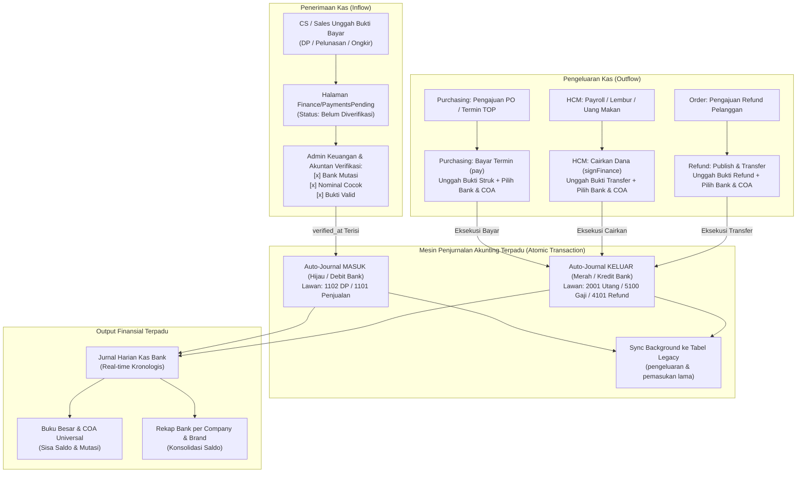

# Rencana Pengembangan Modul Akunting (Accounting) NISGroup

## Blueprint Teknis, Unifikasi Finance & Akunting, Validasi Pembayaran & Approval Terpadu, Jurnal Harian & Buku Besar

Dokumen ini merupakan perencanaan teknis, arsitektur data, logika perizinan, dan skema implementasi untuk modul **Akunting (Accounting)** pada platform NISReport.

### Prinsip Unifikasi Finance & Akunting (Satu Pintu Finansial / One-Stop Financial Gatekeeper)

Berdasarkan evaluasi sistem eksisting, peran **Finance (Keuangan)** dan **Akunting (Akuntan)** **DIGABUNGKAN MENJADI SATU KESATUAN TERPADU**:

1. **Seluruh Sistem Keuangan Lama Berpindah Total ke Akuntan (Full Codebase & Feature Migration)**:
   - Modul Keuangan lama **TIDAK LAGI BERJALAN TERPISAH DI LUAR AKUNTING**. Seluruh kode controller, logic, validasi, dan antarmuka frontend (`InvoiceIndex.jsx`, `InvoiceList.jsx`, `PaymentsPending.jsx`, `RefundIndex.jsx`, `MasterJenisPembayaran.jsx`) **DIPINDAHKAN DAN MENYATU SEPENUHNYA KE DALAM MODUL AKUNTING**.
   - Menu di sidebar diringkas menjadi satu gerbang: **`KEUANGAN & AKUNTING`**. Tidak ada lagi duplikasi menu atau staf bingung membuka dua menu yang berbeda.
2. **Tidak Ada Kerja Dobel (Zero Double Approval)**: Tidak boleh ada alur di mana staf Finance memverifikasi pencairan uang di satu modul, lalu staf Akuntan harus membuka modul lain untuk menyetujui jurnalnya. Satu tindakan verifikasi finansial langsung mengeksekusi status pencairan dana operasional **SEKALIGUS** membukukan jurnal resmi berstatus `POSTED`.
3. **Penyelarasan Penuh dengan Validasi Pembayaran Sistem Lama**:
   - **Penerimaan Kas (Inflow - Order Jersey & Tanda Jadi)**: Mengikuti alur verifikasi pembayaran di `PaymentsPending` dengan **3 Checklist Validasi Pembayaran Wajib** (`bank_mutasi`, `nominal_cocok`, `bukti_valid`). Begitu diverifikasi oleh Keuangan/Akuntan (`verified_at` terisi), Jurnal Harian otomatis terbit sebagai **MASUK (Hijau / Debit Bank)**.
   - **Pengeluaran Kas (Outflow - Purchasing, HCM, Refund, Operasional)**: Menyatukan tombol eksekusi pencairan dana modul Purchasing (`pay`), HCM (`signFinance`), Refund Order (`publish`), dan Pengeluaran Rutin ke dalam mesin penjurnalan Akunting otomatis yang menerbitkan Jurnal Harian **KELUAR (Merah / Kredit Bank)**.
4. **Harmonisasi Data Lama (`pemasukan` & `pengeluaran`)**: Tabel dan riwayat transaksi lama tetap dipertahankan dan disinkronkan di latar belakang (backward compatible). Kategori pengeluaran/pemasukan lama dipetakan ke Master COA Universal terpusat.

---

## 1. Latar Belakang & Ruang Lingkup

### A. Masalah yang Diselesaikan

Sebelum unifikasi ini, operasional Purchasing, HCM, Order, dan Keuangan berjalan terpisah tanpa pembukuan double-entry terpusat:

1. Verifikasi pembayaran customer di modul Order belum otomatis terhubung ke jurnal harian bank brand dan entitas perusahaan (CV).
2. Pencairan pengadaan Purchasing dan gaji/lembur HCM berjalan tanpa penjurnalan real-time ke pos utang/beban dan kas.
3. Potensi kerja 2 kali jika tim Finance dan Akuntan bekerja di menu terpisah.
4. Laporan keuangan belum memiliki buku besar dan rekonsiliasi kas/bank yang sinkron per brand dan per perusahaan.

### B. Ruang Lingkup

1. **Master Data Akunting**: Perusahaan (sumber HCM, read-only), pemetaan perusahaan ke brand (`accounting_company_brands`), Rekening Bank (dinamis dari master brand `bank_accounts`), dan Bagan Akun COA Universal Terpusat (`accounting_coa`).
2. **Satu Meja Verifikasi & Approval Finansial**:
   - Verifikasi Pembayaran Masuk (Order & Tanda Jadi) berbasis 3 Checklist validasi eksisting.
   - Verifikasi & Approval Pembayaran Keluar (Purchasing PO, HCM Payroll/Lembur/Makan, Refund Jersey).
3. **Jurnal Harian Otomatis**: Menampilkan mutasi kas/bank riil dengan format operasional (No, Tgl, Keterangan / No. PO, COA, Keterangan COA, Masuk/Debit, Keluar/Kredit, Saldo Berjalan).
4. **Buku Besar & Neraca Saldo**: Rincian transaksi per akun COA dengan filter fleksibel (Company, Brand, Bank, Periode) tanpa nomor jurnal artifisial.
5. **Laporan Keuangan Terpadu**: Jurnal Harian, Buku Besar, Mutasi per Akun COA, Rekap Bank Berjenjang per Perusahaan, dan Laporan Belanja Pengadaan Purchasing (Departemen, Divisi, Ruko).
6. **Sistem Reminder**: Seluruh pengingat jatuh tempo TOP purchasing, approval aging, dan notifikasi pembukuan.

### C. Batasan

- **Zero Breaking Changes**: Tidak mengubah skema tabel modul lain (`orders`, `order_payments`, `purchasing_*`, `hcm_*`, `pemasukan`, `pengeluaran`).
- Modul Akunting membaca dan mendengarkan (via observer/service) event validasi pembayaran dari modul-modul tersebut, lalu membukukan pembukuan resmi di tabel `accounting_*`.
- Tidak ada ID numerik database yang bocor ke URL publik (memakai `uuid`, `slug`, `kode_akun`).

---

## 2. Prinsip Arsitektur & Isolasi Modul

Selaras dengan instruksi arsitektur NISReport (`CLAUDE.md`) dan pola modul Purchasing:

```
Backend  : App\Http\Controllers\Accounting\* | App\Models\Accounting\* | App\Services\Accounting\*
Frontend : resources/js/Pages/Accounting/*
Routes   : routes/accounting.php (di-require dari routes/web.php)
Database : tabel berawalan accounting_*
Support  : entri di App\Support\AccountingRegistry (opsional) + App\Support\ReportRegistry
```

Aturan wajib:

1. **Zero Breaking Changes**: tidak ada `alter table` pada tabel modul lain.
2. **Shared Core Services**: memakai `App\Services\ActivityLogger`, `App\Services\Notifications\NotificationDispatcher`, dan Spatie Permission yang sudah ada.
3. **Company & Brand Context**:
   - Modul **Order Penjualan** terikat ke `brand_id` dan rekening kas/bank penerima (`bank_accounts.id`). Modul Akunting memetakan `brand_id` ke perusahaan (`company_ref`) via tabel pivot `accounting_company_brands`.
   - Modul **HCM** mengikat karyawan, kontrak, dan slip gaji langsung ke entitas hukum (`legal_entity` / `entitas_cv`) di master HCM.
   - Modul **Purchasing** mengikat pengadaan ke pemohon (`requester_employee_id` yang memiliki `legal_entity` dan departemen).
4. **Non-ID Base URL**: route model binding memakai `uuid` dan `journal_number`.
5. **Phase-Gate Execution**: tiap fase wajib selesai dan teruji sebelum lanjut.

---

## 3. Master Data Akunting

Prinsip **Single Source of Truth**: data **Perusahaan** tidak dibuat ulang di modul Akunting, melainkan diambil dari HCM. Akunting hanya menyimpan pemetaan perusahaan ke brand, sedangkan bank menempel pada brand.

### A. Perusahaan (Sumber HCM, Read-Only)

Perusahaan adalah entitas hukum (Entitas CV) yang sudah dikelola di HCM.

- Sumber data: `HcmMasterOption::getOptions('legal_entity')` (kategori `entitas_cv`). Contoh: `CV Bawang Merah`, `CV Bawang Putih`.
- Profil perusahaan (nama resmi, alamat, website) dibaca dari `SystemSetting` grup `hcm_profile` dan `company`.
- Tidak ada CRUD perusahaan di modul Akunting. Kunci perusahaan adalah nilai `legal_entity` dari HCM, disimpan sebagai `company_ref`.
- Jika HCM menambah entitas baru, modul Akunting langsung mengenalinya tanpa perubahan skema.

### B. Pemetaan Perusahaan ke Brand (`accounting_company_brands`)

Satu perusahaan membawahi banyak brand. Peta ini menghubungkan transaksi ber-`brand_id` ke perusahaan (entitas hukum) yang menaunginya.

- Field: `company_ref` (nilai `legal_entity` dari HCM), `brand_id` (FK `brands`), `is_primary`, timestamps.
- Unik gabungan `(company_ref, brand_id)`.

### C. Bank (Sumber Master Brand, Dinamis)

Rekening bank (akun bank) diambil dinamis dari master bank milik tiap brand, tidak dibuat ulang di modul Akunting.

- Sumber data: `bank_accounts` (master Brand > Bank, sudah brand-scoped, field `bank`, `atas_nama`, `nomor_rekening`), diakses lewat relasi `Brand::bankAccounts()`.
- Setiap baris jurnal yang menyentuh kas atau bank merujuk ke `bank_account_id` (FK `bank_accounts.id`), sehingga yang muncul hanya akun bank milik brand transaksi tersebut.
- Bila brand belum punya akun bank, form approval menonaktifkan pilihan bank dan menampilkan tautan untuk menambah akun di master Bank brand tersebut.

### D. Akun COA Terpusat / Universal (`accounting_coa`)

Bagan Akun (Chart of Accounts) dirancang bersifat **Universal (Shared Global)** untuk seluruh grup usaha. Akun COA **TIDAK PERLU diinput berulang kali per company**.

- **Prinsip Bebas Dobel Input**: Akuntan cukup mendaftarkan akun satu kali (misal: `1101 PENJUALAN`, `5002 BIAYA IKLAN`). Seluruh entitas perusahaan (`CV Bawang Merah`, `CV Bawang Putih`, dll.) dan seluruh brand otomatis dapat langsung menggunakannya.
- `kode_akun`: kode unik akun secara global (misal `1101`, `1102`, `2001`, `5002`). Tidak ada duplikasi kode.
- `keterangan`: nama akun (misal `PENJUALAN`, `PERSEDIAAN`, `UTANG USAHA`).
- `kelompok`: DEBIT atau KREDIT.
- `company_ref`: NULLABLE. Secara default bernilai `NULL` (artinya berlaku **UNIVERSAL** untuk seluruh company). Kolom ini hanya diisi jika di masa depan ada akun sangat spesifik yang hanya boleh digunakan oleh satu company tertentu.
- `is_active`: status aktif.

> **Pemisahan Pembukuan Tetap Terjamin**: Meskipun bagan COA dipakai bersama secara terpusat, **laporan pembukuan (Buku Besar & Neraca Saldo) per perusahaan tetap terpisah rapi 100%**. Hal ini karena setiap transaksi di `accounting_journals` selalu mengunci `company_ref` dan `brand_id` masing-masing transaksi.

Bagan Akun Standar Universal Resmi (47 Akun Terpusat siap pakai untuk seluruh company & brand):

| KODE COA | KETERANGAN AKUN | KELOMPOK | PERUNTUKAN / ARUS TRANSAKSI |
| :--- | :--- | :--- | :--- |
| **1001** | SALDO AWAL | DEBIT | Saldo awal buku kas & bank pada awal periode pembukuan |
| **1101** | PENJUALAN | DEBIT | Pendapatan omzet penjualan order jersey, pelunasan PO, tambahan produk, ongkir |
| **1102** | PERSEDIAAN | DEBIT | Penerimaan uang muka / Down Payment (DP 1, DP 2, DP 3) pesanan customer |
| **1103** | PENDAPATAN LAIN-LAIN | DEBIT | Pendapatan non-operasional di luar penjualan jersey |
| **1104** | PERALATAN | KREDIT | Pengadaan inventaris & peralatan kantor/produksi (Capex) |
| **1105** | PERLENGKAPAN | KREDIT | Pengadaan perlengkapan kantor/pabrik habis pakai |
| **2001** | UTANG USAHA | KREDIT | Utang vendor kain/bahan baku, tagihan TOP purchasing |
| **2201** | REFUND | KREDIT | Pengembalian dana, refund order customer karena retur/cacat |
| **2202** | KAS KECIL | KREDIT | Dana kas kecil (Petty Cash) operasional tunai |
| **3001** | BIAYA PRODUKSI | KREDIT | Pembelian bahan baku riil & biaya pokok produksi jersey |
| **3301** | BIAYA IKLAN | KREDIT | Biaya iklan digital berbayar (Meta Ads, Google Ads, TikTok Ads) |
| **3302** | BIAYA MARKETING | KREDIT | Biaya kampanye promosi, photoshoot, dan materi pemasaran |
| **3303** | BIAYA ONGKIR CUSTOMER | KREDIT | Subsidi ongkos kirim ekspedisi untuk pelanggan |
| **3304** | BIAYA ONGKIR PRODUKSI | KREDIT | Ekspedisi angkut bahan baku dan logistik antar-pabrik |
| **3305** | BIAYA RUMAH TANGGA KANTOR | KREDIT | Kebutuhan rumah tangga kantor (air galon, kebersihan, pantry) |
| **3306** | BIAYA PERBAIKAN INVENTARIS KANTOR | KREDIT | Servis & perawatan komputer, AC, printer, meja kantor |
| **3307** | BIAYA PERBAIKAN KENDARAAN KANTOR | KREDIT | Servis & perawatan rutin mobil/motor dinas operasional |
| **3308** | BIAYA PERBAIKAN RUKO | KREDIT | Perawatan, pengecatan, dan perbaikan fisik bangunan ruko |
| **3309** | BIAYA BANGUNAN DALAM PROSES | KREDIT | Biaya renovasi & konstruksi fisik bangunan sedang berjalan |
| **3310** | BIAYA AIR DAN SAMPAH | KREDIT | Iuran rutin kebersihan lingkungan, pembuangan sampah, dan air |
| **3311** | BIAYA LISTRIK | KREDIT | Pembayaran tagihan listrik PLN pabrik dan kantor |
| **3312** | BIAYA PDAM | KREDIT | Pembayaran tagihan air PDAM |
| **3313** | BIAYA INTERNET, TELEPON | KREDIT | Langganan internet WiFi kantor (IndiHome/Biznet) dan pulsa |
| **3314** | BIAYA SEWA | KREDIT | Biaya sewa ruko, sewa gudang, dan parkir kendaraan |
| **3315** | BIAYA GAJI | KREDIT | Pembayaran payroll gaji pokok karyawan HCM |
| **3316** | BIAYA TRAINING | KREDIT | Pelatihan, sertifikasi, dan pengembangan skill karyawan |
| **3317** | BIAYA UANG MAKAN KARYAWAN | KREDIT | Pencairan tunjangan uang makan harian karyawan HCM |
| **3318** | BIAYA BONUS JAHIT | KREDIT | Insentif & bonus capaian target tim sewing/jahit |
| **3319** | BIAYA BONUS PENJUALAN | KREDIT | Komisi dan bonus pencapaian target tim sales / CS |
| **3320** | BIAYA LEMBUR | KREDIT | Upah lembur operasional karyawan pabrik HCM |
| **3321** | BIAYA HONOR HARIAN | KREDIT | Upah pekerja harian lepas / tenaga bantuan |
| **3322** | BIAYA UPAH BORONGAN | KREDIT | Upah kerja sistem borongan produksi |
| **3323** | BIAYA MAKLOON JAHIT | KREDIT | Biaya pengerjaan jahit ke mitra konveksi luar (makloon) |
| **3324** | BIAYA FEE BRAND AMBASADOR / INFLUENCER | KREDIT | Kontrak fee Brand Ambassador & jasa endorsement influencer |
| **3325** | BIAYA REWARD KARYAWAN | KREDIT | Apresiasi & penghargaan karyawan berprestasi / best employee |
| **3326** | BIAYA PAJAK | KREDIT | Setoran pajak negara (PPN, PPh Final, pajak daerah) |
| **3327** | BIAYA KONSULTAN PAJAK | KREDIT | Jasa profesional konsultan perpajakan & akuntan publik |
| **3328** | BIAYA OOPERASIONAL | KREDIT | Biaya operasional harian kantor & operasional umum |
| **3329** | BIAYA TRANSPPORTASI | KREDIT | BBM kendaraan, tiket perjalanan dinas, e-toll, ojek online |
| **3330** | BIAYA KONSUMSI | KREDIT | Konsumsi rapat kerja, jamuan tamu kantor, makan lembur |
| **3331** | BIAYA PENGEMBANGAN | KREDIT | Riset & pengembangan model/desain produk baru (R&D) |
| **3332** | BIAYA SUMBANGAN | KREDIT | Donasi sosial, zakat perusahaan, CSR lingkungan sekitar |
| **3333** | BIAYA ADMIN | KREDIT | Biaya administrasi transfer bank, biaya gateway & QRIS |
| **3334** | BIAYA LAIN-LAIN | KREDIT | Pengeluaran insidental yang belum memiliki pos khusus |
| **4001** | BRI JET (COA BCA) | KREDIT | Rekening perantara / mutasi kliring BRI JET ke BCA |
| **4401** | BCA JET (COA BRI) | KREDIT | Rekening perantara / mutasi kliring BCA JET ke BRI |
| **4402** | BRI ALLE (COA BCA) | KREDIT | Rekening perantara / mutasi kliring BRI Allegiant ke BCA |
| **4403** | BCA ALLE (COA BRI) | KREDIT | Rekening perantara / mutasi kliring BCA Allegiant ke BRI |

#### Spesifikasi Seeder: `database/seeders/AccountingCoaSeeder.php`

Seeder ini bersifat idempoten (`updateOrCreate` berdasarkan `kode_akun`) dan siap dieksekusi pada Fase 1:

```php
namespace Database\Seeders;

use Illuminate\Database\Seeder;
use App\Models\Accounting\AccountingCoa;

class AccountingCoaSeeder extends Seeder
{
    public function run(): void
    {
        $coaList = [
            ['kode_akun' => '1001', 'keterangan' => 'SALDO AWAL', 'kelompok' => 'DEBIT'],
            ['kode_akun' => '1101', 'keterangan' => 'PENJUALAN', 'kelompok' => 'DEBIT'],
            ['kode_akun' => '1102', 'keterangan' => 'PERSEDIAAN', 'kelompok' => 'DEBIT'],
            ['kode_akun' => '1103', 'keterangan' => 'PENDAPATAN LAIN-LAIN', 'kelompok' => 'DEBIT'],
            ['kode_akun' => '1104', 'keterangan' => 'PERALATAN', 'kelompok' => 'KREDIT'],
            ['kode_akun' => '1105', 'keterangan' => 'PERLENGKAPAN', 'kelompok' => 'KREDIT'],
            ['kode_akun' => '2001', 'keterangan' => 'UTANG USAHA', 'kelompok' => 'KREDIT'],
            ['kode_akun' => '2201', 'keterangan' => 'REFUND', 'kelompok' => 'KREDIT'],
            ['kode_akun' => '2202', 'keterangan' => 'KAS KECIL', 'kelompok' => 'KREDIT'],
            ['kode_akun' => '3001', 'keterangan' => 'BIAYA PRODUKSI', 'kelompok' => 'KREDIT'],
            ['kode_akun' => '3301', 'keterangan' => 'BIAYA IKLAN', 'kelompok' => 'KREDIT'],
            ['kode_akun' => '3302', 'keterangan' => 'BIAYA MARKETING', 'kelompok' => 'KREDIT'],
            ['kode_akun' => '3303', 'keterangan' => 'BIAYA ONGKIR CUSTOMER', 'kelompok' => 'KREDIT'],
            ['kode_akun' => '3304', 'keterangan' => 'BIAYA ONGKIR PRODUKSI', 'kelompok' => 'KREDIT'],
            ['kode_akun' => '3305', 'keterangan' => 'BIAYA RUMAH TANGGA KANTOR', 'kelompok' => 'KREDIT'],
            ['kode_akun' => '3306', 'keterangan' => 'BIAYA PERBAIKAN INVENTARIS KANTOR', 'kelompok' => 'KREDIT'],
            ['kode_akun' => '3307', 'keterangan' => 'BIAYA PERBAIKAN KENDARAAN KANTOR', 'kelompok' => 'KREDIT'],
            ['kode_akun' => '3308', 'keterangan' => 'BIAYA PERBAIKAN RUKO', 'kelompok' => 'KREDIT'],
            ['kode_akun' => '3309', 'keterangan' => 'BIAYA BANGUNAN DALAM PROSES', 'kelompok' => 'KREDIT'],
            ['kode_akun' => '3310', 'keterangan' => 'BIAYA AIR DAN SAMPAH', 'kelompok' => 'KREDIT'],
            ['kode_akun' => '3311', 'keterangan' => 'BIAYA LISTRIK', 'kelompok' => 'KREDIT'],
            ['kode_akun' => '3312', 'keterangan' => 'BIAYA PDAM', 'kelompok' => 'KREDIT'],
            ['kode_akun' => '3313', 'keterangan' => 'BIAYA INTERNET, TELEPON', 'kelompok' => 'KREDIT'],
            ['kode_akun' => '3314', 'keterangan' => 'BIAYA SEWA', 'kelompok' => 'KREDIT'],
            ['kode_akun' => '3315', 'keterangan' => 'BIAYA GAJI', 'kelompok' => 'KREDIT'],
            ['kode_akun' => '3316', 'keterangan' => 'BIAYA TRAINING', 'kelompok' => 'KREDIT'],
            ['kode_akun' => '3317', 'keterangan' => 'BIAYA UANG MAKAN KARYAWAN', 'kelompok' => 'KREDIT'],
            ['kode_akun' => '3318', 'keterangan' => 'BIAYA BONUS JAHIT', 'kelompok' => 'KREDIT'],
            ['kode_akun' => '3319', 'keterangan' => 'BIAYA BONUS PENJUALAN', 'kelompok' => 'KREDIT'],
            ['kode_akun' => '3320', 'keterangan' => 'BIAYA LEMBUR', 'kelompok' => 'KREDIT'],
            ['kode_akun' => '3321', 'keterangan' => 'BIAYA HONOR HARIAN', 'kelompok' => 'KREDIT'],
            ['kode_akun' => '3322', 'keterangan' => 'BIAYA UPAH BORONGAN', 'kelompok' => 'KREDIT'],
            ['kode_akun' => '3323', 'keterangan' => 'BIAYA MAKLOON JAHIT', 'kelompok' => 'KREDIT'],
            ['kode_akun' => '3324', 'keterangan' => 'BIAYA FEE BRAND AMBASADOR / INFLUENCER', 'kelompok' => 'KREDIT'],
            ['kode_akun' => '3325', 'keterangan' => 'BIAYA REWARD KARYAWAN', 'kelompok' => 'KREDIT'],
            ['kode_akun' => '3326', 'keterangan' => 'BIAYA PAJAK', 'kelompok' => 'KREDIT'],
            ['kode_akun' => '3327', 'keterangan' => 'BIAYA KONSULTAN PAJAK', 'kelompok' => 'KREDIT'],
            ['kode_akun' => '3328', 'keterangan' => 'BIAYA OOPERASIONAL', 'kelompok' => 'KREDIT'],
            ['kode_akun' => '3329', 'keterangan' => 'BIAYA TRANSPPORTASI', 'kelompok' => 'KREDIT'],
            ['kode_akun' => '3330', 'keterangan' => 'BIAYA KONSUMSI', 'kelompok' => 'KREDIT'],
            ['kode_akun' => '3331', 'keterangan' => 'BIAYA PENGEMBANGAN', 'kelompok' => 'KREDIT'],
            ['kode_akun' => '3332', 'keterangan' => 'BIAYA SUMBANGAN', 'kelompok' => 'KREDIT'],
            ['kode_akun' => '3333', 'keterangan' => 'BIAYA ADMIN', 'kelompok' => 'KREDIT'],
            ['kode_akun' => '3334', 'keterangan' => 'BIAYA LAIN-LAIN', 'kelompok' => 'KREDIT'],
            ['kode_akun' => '4001', 'keterangan' => 'BRI JET (COA BCA)', 'kelompok' => 'KREDIT'],
            ['kode_akun' => '4401', 'keterangan' => 'BCA JET (COA BRI)', 'kelompok' => 'KREDIT'],
            ['kode_akun' => '4402', 'keterangan' => 'BRI ALLE (COA BCA)', 'kelompok' => 'KREDIT'],
            ['kode_akun' => '4403', 'keterangan' => 'BCA ALLE (COA BRI)', 'kelompok' => 'KREDIT'],
        ];

        foreach ($coaList as $coa) {
            AccountingCoa::updateOrCreate(
                ['kode_akun' => $coa['kode_akun']],
                [
                    'keterangan'  => $coa['keterangan'],
                    'kelompok'    => $coa['kelompok'],
                    'company_ref' => null, // Universal untuk seluruh company
                    'is_active'   => true,
                ]
            );
        }
    }
}
```

### E. Hierarki Master

```
HCM (Single Source of Truth)
  entitas_cv / legal_entity      ->  Perusahaan (read-only)

Akunting
  accounting_company_brands      ->  Perusahaan membawahi Brand
  bank_accounts.brand_id         ->  Brand memiliki Bank (akun bank, dinamis)
  accounting_coa (Universal)     ->  Bagan Akun Terpusat (Bebas Dobel Input, Dipakai Bersama)

Order Penjualan (Penerimaan Kas & Bank)
  orders.brand_id                ->  Pesanan masuk ber-brand_id
  order_payments.bank_id         ->  Pembayaran masuk ke Bank Brand tertentu
  (Auto-Journal)                 ->  Menghasilkan Jurnal POSTED Perusahaan & Bank Brand

Purchasing (Pengeluaran Operasional & Aset)
  purchasing_master_options      ->  Jenis Transaksi Pembayaran (payment_type)
  purchasing_orders              ->  Pengadaan Opex/Capex terhubung ke entitas pemohon
```

### F. Jenis Transaksi Pembayaran (Sumber Purchasing, Read-Only)

Pilihan jenis transaksi pembayaran pada form approval diambil langsung dari master data Purchasing, tidak dibuat ulang.

- Sumber data: `PurchasingMasterOption::getOptions('payment_type')` (tabel `purchasing_master_options`, kategori `payment_type`).
- Contoh opsi: `Tunai / Kas Kecil`, `Transfer Bank`, `E-Wallet / Dompet Digital`, `QRIS`, `Kartu Kredit / Debit`, `Tempo / Kredit (TOP)`, `Reimburse / Dana Talangan Pribadi`.
- Saat dipilih, nilainya disimpan sebagai `payment_type` (snapshot teks) pada approval dan jurnal, sehingga riwayat tetap konsisten walau opsi master di Purchasing berubah.

---

## 4. Alur Validasi Pembayaran Sistem Lama & Gerbang Approval Terpadu (Finance & Accounting Unified)

### A. Prinsip Unifikasi: Meja Finansial Satu Pintu (Zero Double Work)

Di NISGroup, peran **Admin Keuangan (Finance)** dan **Akuntan (Accounting)** bekerja sebagai satu kesatuan tim:

- **TIDAK ADA PROSES DUA KALI**: Tidak ada skenario di mana Keuangan memverifikasi transfer/cairkan dana di satu menu, lalu Akuntan harus membuka antrean lain untuk menyetujui jurnal.
- **Eksekusi Atomik (Single Atomic Transaction)**: Setiap tindakan validasi pembayaran atau pencairan dana langsung:
  1. Mengubah status operasional modul asal (`PAID`, `PAID_COMPLETED`, `published`, `verified`).
  2. Menerbitkan **Jurnal Harian Kas Resmi** berstatus `POSTED` (seimbang debit-kredit, mengikat Company dan Rekening Bank Brand).
  3. Memperbarui saldo berjalan di **Buku Besar** dan **Laporan Kas/Bank** secara detik itu juga (real-time).
  4. Tetap mengisi rekam jejak di tabel legacy `pengeluaran` / `pemasukan` (backward compatibility).

---

### B. Validasi Pembayaran Uang Masuk (Inflow: Order Jersey & Tanda Jadi Desain)

#### 1. Validasi Pembayaran Order Penjualan (Halaman `Finance/PaymentsPending`)

Sistem lama telah memiliki mekanisme verifikasi pembayaran yang sangat terstruktur di [InvoiceController.php:L629-L715](file:///c:/laragon/www/reportlaravel/app/Http/Controllers/Order/InvoiceController.php#L629-L715) dan [InvoiceController.php:L1105-L1146](file:///c:/laragon/www/reportlaravel/app/Http/Controllers/Order/InvoiceController.php#L1105-L1146):

- **Alur Pengajuan**: Saat CS/Sales mengunggah bukti transfer customer (DP, Pelunasan, Ongkir, Tambahan Produk), data tersimpan di `order_payments` dengan status belum diverifikasi (`verified_at IS NULL`).
- **Antrean Verifikasi**: Pembayaran ini masuk ke halaman kerja Keuangan/Akuntan di menu **`Finance > Pembayaran Pending` (`Finance/PaymentsPending`)**.
- **3 Checklist Validasi Pembayaran Wajib**:
  Admin Keuangan / Akuntan wajib memeriksa transaksi dan mencentang 3 poin validasi:
  1. `[x] bank_mutasi`: Mutasi bank riil sudah dicek dan benar-benar masuk di rekening koran / m-banking brand.
  2. `[x] nominal_cocok`: Nominal transfer tepat sama dengan tagihan order / invoice.
  3. `[x] bukti_valid`: File bukti transfer asli, valid, dan bukan bukti palsu/rekayasa.
  4. `verification_notes`: Catatan audit verifikator jika ada penyesuaian/keterangan khusus.

#### 2. Titik Pemicu Resmi Auto-Journaling Uang Masuk

Saat tombol **"Verifikasi Pembayaran"** (`verifyPayment`) disubmit:

```php
$payment->update([
    'verified_by' => $user->id,
    'verified_at' => now(),
    'verification_checks' => [
        'bank_mutasi'   => true,
        'nominal_cocok' => true,
        'bukti_valid'   => true,
    ],
    'verification_notes' => $request->notes,
]);
```

- **Pemicu Jurnal Otomatis**: Event `isDirty('verified_at')` di `OrderPaymentObserver` langsung memanggil `OrderAutoJournalService` untuk menerbitkan Jurnal Harian:
  - **Baris DEBIT**: Akun `1100 KAS & BANK` (mengikat `bank_account_id` rekening brand penerima transfer).
  - **Baris KREDIT**:
    - Jika pembayaran DP: Akun `1102 PERSEDIAAN / UANG MUKA`.
    - Jika Pelunasan, Ongkir, atau Tambahan Produk: Akun `1101 PENJUALAN`.
  - **Teks Keterangan**: Murni teks operasional riil (contoh: `DP KAIZEN FC`, `PELUNASAN + ONGKIR IBI`).
  - **Status Jurnal**: Langsung `POSTED` (masuk ke buku kas bank dan buku besar CV).
- **Integritas Tagihan**: Total tagihan invoice dan order tersinkron otomatis (`is_lunas = true` jika sisa tagihan $\le 0$).

#### 3. Validasi Tanda Jadi Desain (Design Deposit)

- Diatur di [DesignDepositController.php:L67-L120](file:///c:/laragon/www/reportlaravel/app/Http/Controllers/Order/DesignDepositController.php#L67-L120):
- Saat pelanggan transfer uang muka desain, status `pending`.
- Keuangan/Akuntan klik verifikasi (`verify`) $\rightarrow$ terbit `verified_at` dan otomatis tercatat sebagai Jurnal Kas Masuk dengan COA `1102 (PERSEDIAAN / UANG MUKA)`.
- Saat dikonversi menjadi pesanan resmi (`convertToOrder`), status deposit menjadi `converted` dan otomatis membuat baris `OrderPayment` bertipe `dp` yang sudah terverifikasi tanpa pencatatan ganda.

---

### C. Validasi & Approval Pembayaran Uang Keluar (Outflow: Purchasing, HCM, Refund)

Seluruh pengeluaran uang disatukan ke dalam **Satu Gerbang Eksekusi & Penjurnalan**:

#### 1. Pembayaran Termin Pengadaan Purchasing (`PurchasingPaymentController::pay`)

- **Titik Eksekusi**: Sesuai alur di [PurchasingPaymentController.php:L50-L60](file:///c:/laragon/www/reportlaravel/app/Http/Controllers/Purchasing/PurchasingPaymentController.php#L50-L60) dan [PurchasingPaymentService.php:L100-L125](file:///c:/laragon/www/reportlaravel/app/Services/Purchasing/PurchasingPaymentService.php#L100-L125).
- **Form Validasi Pembayaran**:
  - Tanggal Bayar (`paid_at`)
  - Rekening Bank Pembayar (`bank_account_id` milik brand/CV)
  - Metode Pembayaran (`payment_method`: Transfer Bank, Kas Tunai, Giro)
  - Unggah Bukti Struk/Transfer (`receipt_file`): File disimpan di `storage/purchasing/receipts/` dan full URL-nya wajib di-expose untuk laporan & ekspor/salin Excel.
  - Catatan Pembayaran (`notes`)
  - Akun COA Terkait (Otomatis terisi `2001 UTANG USAHA` untuk termin TOP vendor, atau `1104 PERALATAN` untuk Capex mesin/alat, atau `3328 BIAYA OOPERASIONAL` untuk Opex)
- **Dampak Serentak**:
  - Termin pembayaran Purchasing berstatus `PAID` (dan PO berstatus `PAID_COMPLETED` jika seluruh termin lunas).
  - Jurnal Harian menerbitkan baris **KELUAR (Merah / Kredit Bank)** dengan teks keterangan `PO {no_po} — {nama_pengadaan}`.
  - Sisa Saldo Kas Bank otomatis terpotong.
  - Dokumen bukti bayar siap disalin ke clipboard / diekspor ke Excel sebagai link aktif.

#### 2. Pencairan Payroll Gaji HCM (`HcmPayrollController::signFinance`)

- **Titik Eksekusi**: Sesuai alur di [HcmPayrollController.php:L336-L365](file:///c:/laragon/www/reportlaravel/app/Http/Controllers/Hcm/HcmPayrollController.php#L336-L365).
- **Form Validasi Pembayaran**:
  - Rekening Bank Pembayar (`bank_account_id` CV)
  - Metode Pembayaran (`payment_method`: Transfer Payroll, Tunai)
  - Unggah Bukti Pembayaran Payroll (`payment_proof`)
  - Catatan Keuangan (`finance_notes`)
  - Akun COA Terkait: Otomatis terisi `3315 BIAYA GAJI`.
- **Dampak Serentak**:
  - Batch Payroll HCM berstatus `PAID_COMPLETED` dengan cap tanda tangan `finance_signed_by` dan `finance_signed_at`.
  - Jurnal Harian menerbitkan baris **KELUAR (Merah / Kredit Bank)** dengan keterangan `PAYROLL {bulan_tahun}`.

#### 3. Pencairan Upah Lembur & Uang Makan HCM (`signFinance`)

- **Titik Eksekusi**: Sesuai alur di [HcmOvertimeController.php:L502-L535](file:///c:/laragon/www/reportlaravel/app/Http/Controllers/Hcm/HcmOvertimeController.php#L502-L535) dan [HcmMealAllowanceController.php:L317](file:///c:/laragon/www/reportlaravel/app/Http/Controllers/Hcm/HcmMealAllowanceController.php#L317).
- **Form Validasi Pembayaran**:
  - Rekening Bank Pembayar (`bank_account_id`)
  - Metode Pembayaran (`payment_method`: Kas Tunai / Transfer Bank)
  - Unggah Bukti Pembayaran (`payout_proof`)
  - Catatan Keuangan (`finance_notes`)
  - Akun COA: `3320 BIAYA LEMBUR` (untuk overtime) atau `3317 BIAYA UANG MAKAN KARYAWAN` (untuk meal allowance).
- **Dampak Serentak**:
  - Batch Lembur / Uang Makan berstatus `PAID_COMPLETED`.
  - Jurnal Harian menerbitkan baris **KELUAR (Merah / Kredit Bank)** dengan keterangan `LEMBUR BATCH {nomor}` atau `UANG MAKAN BATCH {nomor}`.

#### 4. Eksekusi Refund & Retur Order Jersey (`RefundController::publish`)

- **Titik Eksekusi**: Sesuai alur di [RefundController.php](file:///c:/laragon/www/reportlaravel/app/Http/Controllers/Order/RefundController.php) dan [RefundObserver.php:L32-L80](file:///c:/laragon/www/reportlaravel/app/Observers/RefundObserver.php#L32-L80).
- **Form Validasi Pembayaran**:
  - Rekening Bank Pengirim (`bank_account_id` brand)
  - Rekening Bank Tujuan Pelanggan (`customer_bank_name`, `customer_bank_account`)
  - Bukti Transfer Pengembalian Dana (`bukti`)
- **Dampak Serentak**:
  - Status Refund menjadi `published`.
  - Otomatis membuat baris `order_payments` bertipe `return` yang memotong saldo tagihan order.
  - Jurnal Harian menerbitkan baris **KELUAR (Merah / Kredit Bank)** dengan lawan akun `2201 REFUND` dan teks keterangan `REFUND {nama_po}`.

#### 5. Pengeluaran Operasional Rutin (Manual Expense)

- Untuk biaya harian tanpa modul khusus: Iklan Meta Ads (`3301 BIAYA IKLAN`), Sewa/Parkir (`3314 BIAYA SEWA`), Biaya Admin TF (`3333 BIAYA ADMIN`).
- Form input langsung di menu Keuangan/Akunting dengan memilih Akun Bank, Akun COA Beban, dan Teks Keterangan.
- Otomatis menerbitkan Jurnal Kas Keluar `POSTED`.

---

### D. Ringkasan Sinkronisasi Status & Pemicu Seluruh Modul

| Modul Asal | Event / Titik Verifikasi | Status Modul Asal Setelah Lolos | Akun COA Lawan | Posisi Kas/Bank | Teks Keterangan di Jurnal & Buku Besar |
| :--- | :--- | :--- | :--- | :--- | :--- |
| **Order Jersey (DP)** | `AccountingPaymentController::verify` (3 Checklist) | `verified_at` terisi | `1102 PERSEDIAAN` | **MASUK (Debit)** | `DP {nama_po}` |
| **Order Jersey (Pelunasan)** | `AccountingPaymentController::verify` (3 Checklist) | `verified_at` terisi / `is_lunas=true` | `1101 PENJUALAN` | **MASUK (Debit)** | `PELUNASAN {nama_po} + ONGKIR` |
| **Tanda Jadi Desain** | `DesignDepositController::verify` | `verified_at` terisi / `verified` | `1102 PERSEDIAAN` | **MASUK (Debit)** | `TANDA JADI #{deposit_number}` |
| **Purchasing (PO)** | `PurchasingPaymentController::pay` | `PAID` / `PAID_COMPLETED` | `2001 UTANG USAHA` / `1104 PERALATAN` | **KELUAR (Kredit)** | `PO {no_po} — {nama_pengadaan}` |
| **HCM Payroll** | `HcmPayrollController::signFinance` | `PAID_COMPLETED` | `3315 BIAYA GAJI` | **KELUAR (Kredit)** | `PAYROLL {bulan_tahun}` |
| **HCM Lembur** | `HcmOvertimeController::signFinance` | `PAID_COMPLETED` | `3320 BIAYA LEMBUR` | **KELUAR (Kredit)** | `LEMBUR BATCH {nomor}` |
| **HCM Uang Makan** | `HcmMealAllowanceController::signFinance` | `PAID_COMPLETED` | `3317 BIAYA UANG MAKAN KARYAWAN` | **KELUAR (Kredit)** | `UANG MAKAN BATCH {nomor}` |
| **Refund Order** | `RefundController::publish` | `published` / Order Balance Deducted | `2201 REFUND` | **KELUAR (Kredit)** | `REFUND {nama_po}` |
| **Biaya Iklan** | Input Operasional | `POSTED` | `3301 BIAYA IKLAN` | **KELUAR (Kredit)** | `ADS {platform} {keterangan}` |
| **Admin TF** | Input Operasional | `POSTED` | `3333 BIAYA ADMIN` | **KELUAR (Kredit)** | `ADMIN TF` |

---

### E. Harmonisasi Data Lama (`pengeluaran`, `pemasukan`, `kategori_*`)

Untuk menjamin tidak ada kode atau tampilan reporting lama yang mengalami error (backward compatibility):

1. **Pencatatan Ganda Latar Belakang (Shadow Dual-Write)**:
   - Setiap kali Jurnal Kas Masuk terbit dari `OrderPayment`, service tetap mengecek dan mengisi tabel `pemasukan` lama jika belum ada.
   - Setiap kali Jurnal Kas Keluar terbit dari Purchasing, HCM, atau Refund, service tetap mengecek dan mengisi tabel `pengeluaran` lama jika belum ada.
2. **Penyelarasan Master Kategori Lama ke Master COA Universal**:
   - Master `kategori_pengeluaran` lama dipetakan 1-to-1 ke Master COA Universal:
     - Kategori "Operasional" $\rightarrow$ COA `3328 BIAYA OOPERASIONAL`
     - Kategori "Biaya Iklan" $\rightarrow$ COA `3301 BIAYA IKLAN`
     - Kategori "Gaji" $\rightarrow$ COA `3315 BIAYA GAJI`
     - Kategori "Refund" $\rightarrow$ COA `2201 REFUND`
   - Dengan pemetaan ini, seluruh riwayat data lama dapat ditarik ke dalam laporan Buku Besar dan Neraca Saldo secara konsisten.

---

### F. Migrasi Total Sistem Keuangan Lama ke Modul Akunting (Kode Lama Berpindah Penuh ke Akunting)

Seluruh sistem, fitur, controller, dan tampilan yang sebelumnya berada di modul **Finance (Keuangan)** lama (`resources/js/Pages/Finance/*` dan route terkait) **DIPINDAHKAN DAN DILEBUR SECARA TOTAL KE DALAM MODUL AKUNTING**:

1. **Pemindahan Frontend**:
   - `resources/js/Pages/Finance/PaymentsPending.jsx` $\rightarrow$ Berpindah menjadi antarmuka verifikasi kas masuk di Akunting (`Pages/Accounting/PaymentsPending.jsx`).
   - `resources/js/Pages/Finance/InvoiceIndex.jsx` & `InvoiceList.jsx` $\rightarrow$ Berpindah menjadi manajemen invoice & piutang penjualan di Akunting.
   - `resources/js/Pages/Finance/RefundIndex.jsx` $\rightarrow$ Berpindah menjadi pencairan refund di Akunting.
   - `resources/js/Pages/Finance/MasterJenisPembayaran.jsx` $\rightarrow$ Berpindah menjadi master jenis pembayaran di Akunting.
2. **Pemindahan Backend Controller & Logic**:
   - Logika verifikasi pembayaran (`paymentsPending`, `verifyPayment`, `updatePayment`, `destroyPayment`, `cancelValidation`) yang sebelumnya menumpang di `InvoiceController` dipindahkan ke controller resmi Akunting (`AccountingPaymentVerificationController`).
   - Logika pencairan refund dipindahkan ke `AccountingRefundController`.
   - Logika master jenis pembayaran dipindahkan ke `AccountingMasterController`.
   - Route lama di `routes/web.php` dialihkan (*redirect/alias*) ke route Akunting di `routes/accounting.php` sehingga tidak ada link yang patah.

#### 1. Tabel Pemetaan Perpindahan Kode Keuangan Lama ke Akunting

| Fitur / Kode Keuangan Lama | File Lama (Sebelumnya) | Lokasi Baru di Modul Akunting | Peran & Dampak di Akunting Baru |
| :--- | :--- | :--- | :--- |
| **`InvoiceIndex.jsx`**<br>(Ringkasan Keuangan) | - `total_lunas` (Pemasukan Lunas)<br>- `total_belum_lunas` (Piutang Aktif)<br>- `total_tanda_jadi` (Booking Desain)<br>- `total_pending` (Mutasi Pending)<br>- `brand_breakdown` (Per Brand) | - `total_lunas` $\leftrightarrow$ Kredit COA `1101 PENJUALAN`<br>- `total_belum_lunas` $\leftrightarrow$ Debit COA `1201 PIUTANG USAHA`<br>- `total_tanda_jadi` $\leftrightarrow$ Kredit COA `1102 UANG MUKA`<br>- `total_pending` $\leftrightarrow$ Unverified Inflow<br>- Brand $\leftrightarrow$ Akun Bank Brand & Perusahaan CV | Menggunakan **Single Source of Truth** yang sama sehingga angka di Ringkasan Keuangan **TIDAK PERNAH BERBEDA (Rp 0 selisih)** dengan angka di Buku Besar / Neraca Saldo Akunting. |
| **`InvoiceList.jsx`**<br>(Daftar Invoice & Record PO) | - Daftar Invoice (`INV-...`)<br>- Record PO (`no_po`, `nama_po`)<br>- Pelanggan, Diskon, Ongkir<br>- Rincian Pembayaran Masuk (`OrderPayment`)<br>- Tanda Jadi Desain (`DesignDeposit`) | - Setiap invoice berstatus `validated`/`paid` memiliki catatan jurnal resmi.<br>- Setiap pembayaran DP/Pelunasan/Ongkir terikat ke baris Jurnal Harian Bank Brand. | Di tabel `InvoiceList.jsx`, ditambahkan badge **`TERJURNAL`** (beserta info Bank & CV penerima). Staf dapat melihat status pembukuan tanpa berpindah menu. |
| **`PaymentsPending.jsx`**<br>(Validasi Mutasi Rekening) | - Antrean setoran masuk dari Sales/CS<br>- Bukti transfer (`proof_file`)<br>- Checklist 3 Poin Mutasi Bank | - Saat checklist 3 poin disetujui, langsung memicu terbitnya baris Jurnal Harian MASUK (Hijau / Debit Bank). | Eksekusi di modal verifikasi langsung mengisi `verified_at` dan memanggil `OrderAutoJournalService` secara atomik. |
| **`RefundIndex.jsx`**<br>(Kelola Refund & Retur) | - Pengajuan Refund (`RFD-...`)<br>- Masalah: Cacat produk, retur size<br>- Nominal refund & bukti transfer | - Debit COA `4101 RETUR & REFUND` / kontra `1101`<br>- Kredit COA `1100 KAS & BANK` | Saat refund di-`publish`, saldo tagihan order terpotong, pengeluaran tercatat, dan Jurnal Kas Keluar terbit seketika. |
| **`MasterJenisPembayaran.jsx`**<br>(Master Tipe Pembayaran) | - Master jenis pembayaran: `DP 1`, `DP 2`, `Pelunasan`, `Full Payment`, `Ongkir`, `Tambahan Produk`, `Cashback`, `Return` | - Memetakan perilaku debit/kredit dan akun COA tujuan default. | Setiap penambahan atau perubahan jenis pembayaran langsung selaras dengan pemetaan jurnal akuntansi. |

#### 2. Penanganan Siklus Hidup Pembayaran Penjualan (Create, Verify, Edit, Void, Delete)

Untuk menjamin integritas data (Zero-Discrepancy Guarantee) antara modul Keuangan lama dan Akunting baru:

1. **Input Pembayaran Baru (Draft)**:
   - CS/Sales menginput pembayaran di form order/invoice $\rightarrow$ tersimpan di `order_payments` dengan `verified_at = NULL`.
   - Masuk antrean `PaymentsPending.jsx`. Jurnal kas **belum terbit** (mencegah pencatatan uang fiktif).
2. **Verifikasi Pembayaran (Approve 3 Checklist)**:
   - Admin Keuangan / Akuntan memverifikasi di `PaymentsPending.jsx`.
   - `verified_at` terisi $\rightarrow$ Jurnal Harian terbit otomatis berstatus `POSTED` (Debit Bank Brand, Kredit COA Uang Muka / Penjualan).
   - Sinkronisasi instan ke `Pemasukan::create` (backward compatibility).
3. **Koreksi / Edit Pembayaran (`InvoiceController::updatePayment`)**:
   - Jika nominal, tanggal, atau rekening bank pembayaran diedit di frontend Keuangan:
   - Jurnal akunting lama otomatis dikoreksi / disesuaikan sesuai nominal & tanggal baru.
   - Perubahan tercatat di `POChangeLog` dan saldo kas bank terkoreksi otomatis.
4. **Hapus Pembayaran (`InvoiceController::destroyPayment`)**:
   - Jika pembayaran yang sudah diverifikasi dihapus oleh Admin Keuangan/Superadmin:
   - Jurnal akunting yang terikat otomatis di-`VOID` / dihapus dari buku besar.
   - Mutasi kas bank ditarik kembali dan sisa tagihan invoice/order kembali bertambah.
5. **Batal Validasi Invoice (`InvoiceController::cancelValidation`)**:
   - Jika validasi invoice dibatalkan:
   - Status invoice kembali ke `published` atau `draft`, dan status lunas order dicabut (`is_lunas = false`). Jurnal akuntansi menyesuaikan secara seimbang.

---

### G. Diagram Alur Terpadu (Finance & Accounting Unified)



---

### H. Arsitektur Dynamic Live Query & Two-Way Sync Lifecycle (Jaminan Anti-Malfungsi & Zero Data Loss)

Untuk menjamin **100% INTEGRITAS DATA, TIDAK ADA MISS DATA, DAN TIDAK TERJADI MALFUNGSI** saat data ditarik lintas modul (Order, Finance, Purchasing, HCM, Master Bank, Master Brand, Master Company):

#### 1. Masalah Utama pada Sistem Akuntansi Tradisional (Pemicu Malfungsi)

Pada sistem pasif biasa, data akuntansi sering rusak/selisih karena:

1. **Stale Snapshot**: Data penjualan di-copy ke tabel akuntansi saat tombol ditekan. Jika kasir/sales mengubah nominal pembayaran atau rekening bank di kemudian hari, data akuntansi menjadi usang (desync).
2. **Missing Termin**: Query hanya mengambil pembayaran terakhir (`latest()`), akibatnya DP 1 dan DP 2 hilang tertimpa pelunasan.
3. **Orphan Records**: Transaksi order atau purchasing dihapus, tetapi baris jurnal tetap menggantung, sehingga laporan kas bank tidak cocok dengan rekening koran.

#### 2. Solusi NISReport: Dual Engine Dinamis (Live Pulling + Event-Driven Two-Way Sync)

Untuk mencegah seluruh potensi malfungsi di atas, Modul Akunting NISReport menerapkan **DUAL ENGINE**:

```
                                      ┌─────────────────────────────────────────────────────────────┐
                                      │              SUMBER DATA TRANSAKSI UTAMA                    │
                                      │  - Order & Payments (orders, order_payments, invoices)      │
                                      │  - Purchasing (purchasing_orders, purchasing_payments)      │
                                      │  - HCM (hcm_payrolls, hcm_overtimes, hcm_meal_allowances)   │
                                      │  - Master Brand & Bank (brands, bank_accounts)              │
                                      │  - Perusahaan CV: HcmMasterOption ('entitas_cv')            │
                                      │  - Peta CV-Brand: accounting_company_brands                 │
                                      └──────────────────────────────┬──────────────────────────────┘
                                                                     │
                                    ┌────────────────────────────────┴────────────────────────────────┐
                                    ▼                                                                 ▼
┌────────────────────────────────────────────────────────┐       ┌────────────────────────────────────────────────────────┐
│           ENGINE 1: DYNAMIC LIVE QUERY AGGREGATOR       │       │        ENGINE 2: EVENT-DRIVEN TWO-WAY OBSERVER SYNC    │
│  (Untuk Laporan Rekap Pajak per PO & Rekap Bank)        │       │  (Untuk Jurnal Harian, Buku Besar, & Kartu COA)        │
│                                                        │       │                                                        │
│  - ZERO DUPLICATION: Tidak menyalin data ke tabel mati │       │  - Observer Lifecycle: Created, Updated, Deleted, Void │
│  - Tarik data dinamis real-time langsung dari relasi   │       │  - Mengikat Foreign Key: (source_module, source_id)    │
│  - Menggunakan SQL Conditional Aggregation (Pivot)     │       │  - Saat payment diedit/dihapus, baris jurnal OTOMATIS  │
│  - Jika DP/Pelunasan diedit di Finance, laporan pajak  │       │    ikut update / di-void secara real-time (Cascade)    │
│    SEKETIKA BERUBAH saat itu juga (100% Live)          │       │  - Transaksi dibungkus DB::transaction (Atomic)        │
└────────────────────────────────────────────────────────┘       └────────────────────────────────────────────────────────┘
```

#### 3. Logika SQL Pivot Dinamis untuk Laporan Pajak per PO (Jaminan DP 1, 2, 3 Lengkap)

Mesin penarikan data dinamis menarik data seluruh termin dalam 1 PO menggunakan teknik **Conditional Aggregation**:

```sql
SELECT 
    orders.id AS order_id,
    invoices.invoice_number AS no_inv,
    orders.nama_po AS nama_po,
    bank_accounts.bank AS bank_nama,
    bank_accounts.atas_nama AS bank_atas_nama,
    orders.is_lunas AS is_lunas,
    -- DP 1
    MAX(CASE WHEN op.payment_type = 'dp' AND op.dp_sequence = 1 THEN op.payment_date END) AS tgl_dp1,
    COALESCE(MAX(CASE WHEN op.payment_type = 'dp' AND op.dp_sequence = 1 THEN op.amount END), 0) AS nominal_dp1,
    -- DP 2
    MAX(CASE WHEN op.payment_type = 'dp' AND op.dp_sequence = 2 THEN op.payment_date END) AS tgl_dp2,
    COALESCE(MAX(CASE WHEN op.payment_type = 'dp' AND op.dp_sequence = 2 THEN op.amount END), 0) AS nominal_dp2,
    -- DP 3
    MAX(CASE WHEN op.payment_type = 'dp' AND op.dp_sequence = 3 THEN op.payment_date END) AS tgl_dp3,
    COALESCE(MAX(CASE WHEN op.payment_type = 'dp' AND op.dp_sequence = 3 THEN op.amount END), 0) AS nominal_dp3,
    -- ONGKIR TERPISAH
    MAX(CASE WHEN op.payment_type = 'ongkir' THEN op.payment_date END) AS tgl_ongkir,
    COALESCE(MAX(CASE WHEN op.payment_type = 'ongkir' THEN op.amount END), 0) AS nominal_ongkir,
    -- PELUNASAN + ONGKIR
    MAX(CASE WHEN op.payment_type = 'pelunasan' THEN op.payment_date END) AS tgl_pelunasan,
    COALESCE(MAX(CASE WHEN op.payment_type = 'pelunasan' THEN op.amount END), 0) AS nominal_pelunasan,
    -- TAMBAHAN PELUNASAN
    MAX(CASE WHEN op.payment_type = 'tambahan_produk' THEN op.payment_date END) AS tgl_tambahan,
    COALESCE(MAX(CASE WHEN op.payment_type = 'tambahan_produk' THEN op.amount END), 0) AS nominal_tambahan,
    -- SELISIH / LEBIHAN TF / RETURN
    MAX(CASE WHEN op.payment_type IN ('cashback', 'return') THEN op.payment_date END) AS tgl_return,
    COALESCE(MAX(CASE WHEN op.payment_type IN ('cashback', 'return') THEN op.amount END), 0) AS nominal_return
FROM orders
LEFT JOIN invoices ON invoices.order_id = orders.id
LEFT JOIN order_payments op ON op.order_id = orders.id AND op.verified_at IS NOT NULL
LEFT JOIN bank_accounts ON bank_accounts.id = op.bank_id
WHERE orders.deleted_at IS NULL
  -- Filter Brand (Spesifik Brand atau Semua Brand)
  AND (:brandId IS NULL OR orders.brand_id = :brandId)
  -- Filter Bank (Spesifik Rekening atau Semua Bank)
  AND (:bankId IS NULL OR op.bank_id = :bankId)
  -- Filter Bulan atau Rentang Tanggal Transaksi (Date Range)
  AND op.payment_date BETWEEN :startDate AND :endDate
GROUP BY orders.id, invoices.invoice_number, orders.nama_po, bank_accounts.bank, bank_accounts.atas_nama, orders.is_lunas;
```

**Keunggulan Mutlak Logika Ini:**

1. **1 PO Tepat Menghasilkan 1 Baris Horizontal**: Tidak akan pernah ada duplikasi baris atau baris loncat.
2. **DP 1, DP 2, DP 3 Terpetakan Presisi**: Berdasarkan `dp_sequence` yang dijamin oleh `OrderPaymentObserver`, berapapun termin DP yang dibayar customer otomatis masuk ke kolomnya masing-masing.
3. **Hanya Mengambil yang Sudah Terverifikasi (`verified_at IS NOT NULL`)**: Menjamin angka yang masuk ke laporan pajak adalah uang yang valid masuk rekening koran bank.

#### 4. Penarikan Dinamis Lintas Modul Purchasing (Karyawan, Departemen, Divisi, Ruko & Tanggal)

Untuk laporan belanja purchasing di akunting, penarikan data dinamis menghubungkan:

```php
$purchasingSpending = PurchasingOrder::query()
    ->with([
        'requester.department',       // Departemen HRIS pemohon
        'requester.division',         // Divisi HRIS pemohon
        'location',                   // Lokasi Fisik Ruko / Pabrik (purchasing_master_options)
        'vendor',                     // Rekanan / Supplier
        'payments' => function ($q) { // Termin pembayaran riil
            $q->where('status', 'PAID');
        }
    ])
    ->when($filters['employee_id'], fn($q, $emp) => $q->where('requester_employee_id', $emp))
    ->when($filters['department'], fn($q, $d) => $q->where('department', $d))
    ->when($filters['division'], fn($q, $div) => $q->where('division', $div))
    ->when($filters['location_id'], fn($q, $loc) => $q->where('location_id', $loc))
    ->when(!empty($filters['start_date']) && !empty($filters['end_date']), function ($q) use ($filters) {
        $q->whereBetween('transaction_date', [$filters['start_date'], $filters['end_date']]);
    })
    ->get();
```

Setiap rupiah belanja purchasing otomatis terklasifikasi ke Karyawan Pemohon, Departemen, Divisi, dan Lokasi Ruko terkait dalam rentang tanggal/bulan yang dipilih.

#### 5. Penarikan Dinamis Hierarki 3 Tingkat (Company -> Brand -> Bank)

Filter laporan akuntansi menggunakan relasi hierarkis reaktif:

```
Company (Master HCM legal_entity)
   └── Brand (accounting_company_brands)
          └── Bank Account (bank_accounts WHERE brand_id = ...)
```

Saat user memilih Company `CV Bawang Merah`, sistem otomatis membatasi opsi Brand hanya untuk brand di bawah CV tersebut, dan otomatis membatasi rekening bank hanya milik brand tersebut. Hal ini mencegah kekeliruan mutasi antar perusahaan.

---

## 5. Jurnal Harian & Buku Besar

### A. Jurnal Harian Transaksional Per Brand (Format Standar Operasional)

Tampilan **Jurnal Harian** dirancang persis dengan format tabel buku kas/bank operasional yang sudah digunakan perusahaan di lapangan (seperti pada spreadsheet referensi):

```
+-----+------------+-------------------------+------+----------------+---------------+---------------+-----------------+
| No. |    TGL     |       KETERANGAN        | COA  | KETERANGAN COA | MASUK (Hijau) | KELUAR (Merah)|      SALDO      |
+-----+------------+-------------------------+------+----------------+---------------+---------------+-----------------+
|  1  | 01/01/2025 | DP PB BCA JAMBI 2       | 1102 | PERSEDIAAN     | Rp 840.000    |               | Rp 123.942.748  |
|  2  | 02/01/2025 | PARKIR LARAS-LIRIS      | 3314 | BIAYA SEWA     |               | Rp 500.000    | Rp 123.442.748  |
|  3  | 02/01/2025 | PELUNASAN + ONGKIR IBI  | 1101 | PENJUALAN      | Rp 554.000    |               | Rp 123.996.748  |
|  4  | 03/01/2025 | PELUNASAN BARAGE FC 4   | 1101 | PENJUALAN      | Rp 234.000    |               | Rp 124.230.748  |
|  5  | 03/01/2025 | DP KAIZEN FC            | 1102 | PERSEDIAAN     | Rp 960.000    |               | Rp 125.190.748  |
|  6  | 03/01/2025 | GIRO-MESIN PRESS ROLL   | 2001 | UTANG USAHA    |               | Rp 7.084.000  | Rp 118.106.748  |
|  7  | 03/01/2025 | DP BARUDAK ATES         | 1102 | PERSEDIAAN     | Rp 360.000    |               | Rp 118.466.748  |
|  8  | 03/01/2025 | DP NINE SEVEN           | 1102 | PERSEDIAAN     | Rp 1.749.000  |               | Rp 120.215.748  |
|  9  | 03/01/2025 | ADS                     | 3301 | BIAYA IKLAN    |               | Rp 10.000.000 | Rp 110.215.748  |
| 10  | 03/01/2025 | ADMIN TF                | 3333 | BIAYA ADMIN    |               | Rp 2.500      | Rp 110.213.248  |
| 11  | 04/01/2025 | CICILAN MOTOR PUTIH     | 2001 | UTANG USAHA    |               | Rp 1.315.000  | Rp 108.898.248  |
| 12  | 04/01/2025 | ADMIN TF                | 3333 | BIAYA ADMIN    |               | Rp 2.500      | Rp 108.895.748  |
| 13  | 04/01/2025 | PELUNASAN BIDPAM        | 1101 | PENJUALAN      | Rp 1.594.000  |               | Rp 110.489.748  |
+-----+------------+-------------------------+------+----------------+---------------+---------------+-----------------+
```

#### 1. Mekanisme Otomatis di Balik Layar (Under The Hood)

Pengguna tidak perlu memilih perusahaan atau akun kas berkali-kali. Sistem secara cerdas mengikat 3 entitas sekaligus:

1. **Mengikat Brand (`brand_id`)**: Setiap mutasi jurnal terisolasi rapi berdasarkan brand aktif / brand transaksi. Pengguna cukup memilih tab Brand atau rekening bank brand terkait.
2. **Mengikat Perusahaan (`company_ref`)**: Melalui relasi `accounting_company_brands`, sistem otomatis mengetahui entitas hukum CV penaung brand (misal: Brand Circle Sportwear $\rightarrow$ `CV Bawang Merah`). Seluruh mutasi ini terkonsolidasi otomatis ke pembukuan CV tersebut.
3. **Mengikat Akun Bank Brand (`bank_account_id`)**: Mutasi kas/bank diikat ke rekening bank spesifik milik brand (`bank_accounts`). Jika brand memiliki 3 rekening (BCA, Mandiri, Kas Tunai), masing-masing rekening memiliki buku mutasi harian dan saldo berjalan sendiri.

#### 2. Logika Masuk & Keluar Otomatis & Standarisasi Keterangan / No. PO

Untuk memastikan **sinkronisasi 100% total** antara Jurnal Harian, Buku Besar, dan Laporan per Akun COA, teks transaksi menggunakan format operasional riil yang seragam (*tanpa nomor jurnal buatan/artifisial*):

- **Baris MASUK (Hijau / Debit Bank)**:
  - **Penerimaan DP Order**: Format `DP {nama_po} ({no_po})` (contoh: `DP KAIZEN FC`, `DP PB BCA JAMBI 2`) $\rightarrow$ Terbit otomatis dengan COA `1102 (PERSEDIAAN)`.
  - **Pelunasan Order**: Format `PELUNASAN {nama_po}` atau `PELUNASAN + ONGKIR {nama_po}` (contoh: `PELUNASAN + ONGKIR IBI`, `PELUNASAN BARAGE FC 4`) $\rightarrow$ Terbit otomatis dengan COA `1101 (PENJUALAN)`.
  - **Tambahan Produk**: Format `TAMBAHAN PRODUK {nama_po}` $\rightarrow$ Terbit otomatis dengan COA `1101 (PENJUALAN)`.
- **Baris KELUAR (Merah / Kredit Bank)**:
  - **Refund / Return Order**: Format `REFUND {nama_po}` (contoh: `REFUND BARAGE FC`) $\rightarrow$ Terbit otomatis mengurangi kas dengan COA `2201 (REFUND)`.
  - **Pengadaan Purchasing**: Format `PO {no_po} — {nama_pengadaan}` (contoh: `PO-202501-0005 GIRO-MESIN PRESS ROLL`, `PO-202501-0012 BAHAN KAIN DRYFIT`) $\rightarrow$ Tercatat dengan COA `2001 (UTANG USAHA)` atau akun beban/peralatan terkait.
  - **Biaya Iklan**: Format `ADS {platform} {keterangan}` (contoh: `ADS META JAN BATCH 1`, `ADS GOOGLE CAMPAIGN`) $\rightarrow$ Tercatat dengan COA `3301 (BIAYA IKLAN)`.
  - **Biaya Admin Transfer**: Format `ADMIN TF` $\rightarrow$ Tercatat dengan COA `3333 (BIAYA ADMIN)`.
  - **Sewa & Operasional**: Format `PARKIR {lokasi}`, `SEWA RUKO {lokasi}` $\rightarrow$ Tercatat dengan COA `3314 (BIAYA SEWA)`.
  - **Gaji & Upah HCM**: Format `PAYROLL {bulan_tahun}` $\rightarrow$ Tercatat dengan COA `3315 (BIAYA GAJI)` / `3320 (BIAYA LEMBUR)` / `3317 (BIAYA UANG MAKAN KARYAWAN)`.
- **Kalkulasi Kolom SALDO**:
  - Saldo berjalan dihitung kronologis per tanggal & urutan transaksi:
    $$\text{Saldo Baris Ini} = \text{Saldo Baris Sebelumnya} + \text{MASUK} - \text{KELUAR}$$
  - Saldo selalu mencerminkan kondisi saldo riil di buku rekening bank brand tersebut.

#### 3. Filter & Kontrol Halaman Jurnal Harian

- **Filter Multi-Level**:
  - **Filter Company (CV)**: Pilih entitas hukum CV (`CV Bawang Merah`, `CV Bawang Putih`, atau Semua CV).
  - **Filter Brand**: Pilih Brand (`Circle Sportwear`, dll, otomatis menyesuaikan dengan CV yang dipilih).
  - **Filter Rekening Bank**: Pilih rekening bank spesifik (`BCA - 12345678`, `Mandiri`, `Kas Tunai`, atau Semua Bank).
  - **Filter Periode**: Pemilih Bulan/Tahun dan Rentang Tanggal (`Date Range`).
- **Otomatisasi Real-Time**:
  - Begitu filter Company, Brand, atau Bank diubah, tabel otomatis memuat data jurnal yang relevan, menghitung ulang **Total Mutasi Masuk (Debit)**, **Total Mutasi Keluar (Kredit)**, dan **Sisa Saldo Berjalan** secara kronologis.
- **Kartu Ringkasan (Top Stats)**:
  - Saldo Awal Periode
  - Total Masuk (Badge Hijau)
  - Total Keluar (Badge Merah)
  - Sisa Saldo Saat Ini
- **Fitur Ekspor**: Ekspor Excel persis dengan format tabel referensi operasional di atas via `ReportRegistry`.

### B. Logika Debit & Kredit (Penambahan vs Pengurangan)

Untuk memudahkan pemahaman pengguna dan selaras dengan laporan Arus Kas eksisting (`ReportRunner.php` & `ReportRegistry.php`):

#### 1. Pada Rekening Kas & Bank Brand (Mutasi Kas Riil)

Mengikuti pola standar sistem NISReport yang sudah berjalan:

- **DEBIT = Penambahan (+) / Uang Masuk**: Setiap ada penerimaan kas/bank (pembayaran order customer, DP, pelunasan), dicatat di posisi **DEBIT**.
- **KREDIT = Pengurangan (-) / Uang Keluar**: Setiap ada pengeluaran kas/bank (belanja vendor purchasing, bayar gaji payroll, refund order), dicatat di posisi **KREDIT**.
- **Rumus Saldo Bersih Bank**:
  $$\text{Saldo Akhir Bank} = \text{Saldo Awal} + \sum \text{Debit (Uang Masuk)} - \sum \text{Kredit (Uang Keluar)}$$
- Selaras 100% dengan flag `is_debit` di `order_payments` (`is_debit = true` untuk masuk, `false` untuk refund/keluar) dan Laporan Arus Kas Bank (`Total Debit (Masuk)` vs `Total Kredit (Keluar)`).

#### 2. Pada Buku Besar & Akun COA Perusahaan (Double-Entry Standar)

Perhitungan saldo berjalan akun disesuaikan dengan **Kelompok COA** (`accounting_coa.kelompok`):

| Kelompok COA | Contoh Akun | Makna DEBIT | Makna KREDIT | Rumus Saldo Berjalan |
| :--- | :--- | :--- | :--- | :--- |
| **DEBIT** (Aset & Beban) | Kas, Bank, Piutang, Aset Tetap, Beban Gaji, Beban Operasional | **Penambahan (+)** | **Pengurangan (-)** | $\text{Saldo} = \text{Saldo Lalu} + \text{Debit} - \text{Kredit}$ |
| **KREDIT** (Kewajiban, Modal, Pendapatan) | Utang Usaha, Uang Muka DP, Modal, Pendapatan Penjualan | **Pengurangan (-)** | **Penambahan (+)** | $\text{Saldo} = \text{Saldo Lalu} + \text{Kredit} - \text{Debit}$ |

#### 3. Bantuan Visual pada Form Input (Approval & Jurnal Manual)

Pada form input perizinan dan jurnal manual, label dropdown posisi dilengkapi teks panduan intuitif:

- `DEBIT (+)`: Penambahan Kas/Bank atau Beban/Aset
- `KREDIT (-)`: Pengurangan Kas/Bank atau Penambahan Pendapatan/Utang

---

### C. Buku Besar (`BukuBesarService`)

Buku besar menampilkan rincian mutasi seluruh transaksi per akun COA dengan filter terpadu:

- **Filter Fleksibel**:
  - **Company (CV)**: Menyaring mutasi yang hanya dimiliki oleh entitas CV tersebut.
  - **Brand**: Menyaring mutasi spesifik brand tertentu.
  - **Rekening Bank**: Menyaring mutasi kas/bank pada rekening bank brand tertentu.
  - **Akun COA**: Pilih akun COA yang ingin dilihat (misal: `1101 PENJUALAN`, `2001 UTANG USAHA`, `5002 BIAYA IKLAN`).
  - **Rentang Tanggal**: Tanggal awal s/d tanggal akhir.
- **Tampilan Data Buku Besar**:
  - **Saldo Awal**: Akumulasi saldo jurnal `POSTED` sebelum tanggal mulai filter.
  - **Tabel Mutasi**: Menampilkan No, Tanggal, **Keterangan / No. PO** (murni teks operasional riil: DP, Pelunasan, Refund, Return, PO Purchasing — *tanpa nomor jurnal artifisial*), Brand, Rekening Bank, Lawan Akun, Mutasi Debit (+), Mutasi Kredit (-), dan **Sisa Saldo Berjalan**.
  - **Saldo Akhir**: Saldo berjalan terkini pada akhir periode yang dipilih.

### D. Neraca Saldo (`TrialBalanceService`)

Rekap total debit dan total kredit per akun COA pada periode tertentu. Karena setiap jurnal dipaksa seimbang, total kolom debit dan kredit seluruh akun wajib sama. Filter mendukung Company dan Rentang Tanggal.

### E. Jurnal Manual

Akuntan dapat membuat jurnal manual tanpa approval (misal jurnal penyesuaian, koreksi, depresiasi aset). Validasi seimbang tetap berlaku. Jurnal manual ditandai `source = MANUAL`.

---

## 6. Sistem Reminder & Notifikasi

### A. Prinsip

Semua pengingat yang ada di modul Purchasing direplikasi ke modul Akunting, dengan penyesuaian konteks pembukuan. Reminder dikirim melalui `NotificationDispatcher` (In-App, WhatsApp, Telegram, Email) plus lonceng suara, persis pola Purchasing dan HCM.

### B. Daftar Reminder

| Event Key | Pemicu | Penerima | Saluran |
| :--- | :--- | :--- | :--- |
| `accounting_approval_pending` | Ada transaksi Purchasing/HCM masuk antrean PENDING | `admin_akunting`, `staff_akunting` | In-App |
| `accounting_approval_aging` | Item PENDING lebih dari H-2 | `admin_akunting`, `owner` | In-App, WhatsApp |
| `accounting_top_due_today` | Tagihan TOP Purchasing jatuh tempo hari ini dan belum dijurnal/dibayar | `admin_akunting`, `admin_keuangan` | In-App, WhatsApp, Sound |
| `accounting_top_overdue` | Tagihan TOP lewat jatuh tempo | `admin_akunting`, `admin_keuangan`, `owner` | In-App, WhatsApp, Telegram |
| `accounting_journal_unposted` | Jurnal DRAFT belum diposting pada akhir hari kerja | `staff_akunting`, `admin_akunting` | In-App |
| `accounting_payroll_due` | Payroll HCM mendekati `payout_date` dan belum dijurnal | `admin_akunting`, `admin_keuangan` | In-App, WhatsApp |
| `accounting_period_closing` | H-3 tutup buku akhir bulan | `admin_akunting`, `owner` | In-App, Email |
| `accounting_imbalance_alert` | Approval tersimpan dengan total debit tidak sama dengan kredit | `admin_akunting` | In-App, Sound |

### C. Mesin Reminder

- Tabel `accounting_reminders` mencatat setiap reminder yang dihasilkan (audit + anti duplikat).
- Kunci unik `(type, ref_type, ref_id, due_date)` mencegah pengiriman ganda untuk reminder yang sama (idempoten), sejalan dengan prinsip observer idempoten pada Order/Refund.
- Scheduled command:
  - `accounting:daily-reminders` setiap hari 07:30 (approval pending, aging, TOP due/overdue, payroll due).
  - `accounting:journal-reminder` setiap hari 17:00 (jurnal belum diposting).
  - `accounting:period-closing` setiap hari 08:00 (aktif H-3 akhir bulan).
- Registrasi jadwal di `routes/console.php`, mengikuti pola `hcm:daily-alerts` dan `hcm:overtime-reminder`.

### D. Widget Dashboard Akunting

Widget mengikuti matriks warna Purchasing (Merah, Kuning, Biru, Hijau, Abu):

- Merah: approval menunggu, TOP jatuh tempo hari ini, jurnal belum diposting menjelang tutup hari.
- Kuning: aging approval, payroll mendekati payout.
- Biru: aktivitas jurnal hari ini.
- Hijau: jurnal hari ini seimbang dan sudah diposting.
- Abu: riwayat approval dan jurnal periode lampau.

---

## 7. Arsitektur Data & Skema Database

Semua tabel InnoDB, foreign key, indeks, dan soft delete.

### 1. `accounting_company_brands`

Peta perusahaan (dari HCM) ke brand. Tidak ada tabel perusahaan milik Akunting.

```sql
CREATE TABLE `accounting_company_brands` (
  `id` BIGINT UNSIGNED AUTO_INCREMENT PRIMARY KEY,
  `company_ref` VARCHAR(150) NOT NULL, -- nilai legal_entity dari HCM
  `brand_id` CHAR(36) NOT NULL,
  `is_primary` BOOLEAN DEFAULT FALSE,
  `created_at` TIMESTAMP NULL,
  `updated_at` TIMESTAMP NULL,
  UNIQUE KEY `uk_acb_company_brand` (`company_ref`, `brand_id`),
  INDEX `idx_acb_company` (`company_ref`),
  INDEX `idx_acb_brand` (`brand_id`),
  CONSTRAINT `fk_acb_brand` FOREIGN KEY (`brand_id`) REFERENCES `brands` (`id`) ON DELETE CASCADE
) ENGINE=InnoDB DEFAULT CHARSET=utf8mb4 COLLATE=utf8mb4_unicode_ci;
```

### 2. `accounting_coa`

Bagan akun universal terpusat (tidak perlu dobel input per company):

```sql
CREATE TABLE `accounting_coa` (
  `id` BIGINT UNSIGNED AUTO_INCREMENT PRIMARY KEY,
  `uuid` CHAR(36) UNIQUE NOT NULL,
  `kode_akun` VARCHAR(30) UNIQUE NOT NULL, -- Unik global, dipakai bersama seluruh company & brand
  `keterangan` VARCHAR(255) NOT NULL,
  `kelompok` ENUM('DEBIT','KREDIT') NOT NULL,
  `company_ref` VARCHAR(150) NULL, -- NULL = Universal (semua company), atau isi jika privat untuk 1 CV
  `is_active` BOOLEAN DEFAULT TRUE,
  `created_at` TIMESTAMP NULL,
  `updated_at` TIMESTAMP NULL,
  `deleted_at` TIMESTAMP NULL,
  INDEX `idx_coa_kelompok` (`kelompok`),
  INDEX `idx_coa_company` (`company_ref`)
) ENGINE=InnoDB DEFAULT CHARSET=utf8mb4 COLLATE=utf8mb4_unicode_ci;
```

### 3. `accounting_approvals`

```sql
CREATE TABLE `accounting_approvals` (
  `id` BIGINT UNSIGNED AUTO_INCREMENT PRIMARY KEY,
  `uuid` CHAR(36) UNIQUE NOT NULL,
  `company_ref` VARCHAR(150) NULL,
  `brand_id` CHAR(36) NULL,
  `source_module` ENUM('PURCHASING','HCM','ORDER','REFUND','MANUAL') NOT NULL,
  `source_type` VARCHAR(100) NOT NULL,
  `source_id` VARCHAR(36) NULL,
  `source_ref` VARCHAR(100) NULL,
  `payment_type` VARCHAR(50) NULL, -- snapshot dari master Purchasing / Jenis Pembayaran
  `transaction_date` DATE NOT NULL,
  `due_date` DATE NULL,
  `description` TEXT NOT NULL,
  `total_amount` DECIMAL(15,2) NOT NULL DEFAULT 0.00,
  `status` ENUM('PENDING','PARTIAL','APPROVED','REJECTED','POSTED') NOT NULL DEFAULT 'PENDING',
  `priority` ENUM('LOW','NORMAL','HIGH','URGENT') NOT NULL DEFAULT 'NORMAL',
  `requested_by` BIGINT UNSIGNED NULL,
  `assigned_to` BIGINT UNSIGNED NULL,
  `approved_by` BIGINT UNSIGNED NULL,
  `approved_at` TIMESTAMP NULL,
  `rejected_reason` TEXT NULL,
  `journal_id` BIGINT UNSIGNED NULL,
  `notes` TEXT NULL,
  `created_by` BIGINT UNSIGNED NOT NULL,
  `created_at` TIMESTAMP NULL,
  `updated_at` TIMESTAMP NULL,
  `deleted_at` TIMESTAMP NULL,
  UNIQUE KEY `uk_approval_source` (`source_module`, `source_type`, `source_id`),
  INDEX `idx_approval_status_date` (`status`, `transaction_date`),
  INDEX `idx_approval_company` (`company_ref`),
  INDEX `idx_approval_brand` (`brand_id`)
) ENGINE=InnoDB DEFAULT CHARSET=utf8mb4 COLLATE=utf8mb4_unicode_ci;
```

### 4. `accounting_approval_lines`

```sql
CREATE TABLE `accounting_approval_lines` (
  `id` BIGINT UNSIGNED AUTO_INCREMENT PRIMARY KEY,
  `uuid` CHAR(36) UNIQUE NOT NULL,
  `approval_id` BIGINT UNSIGNED NOT NULL,
  `line_no` INT UNSIGNED NOT NULL DEFAULT 1,
  `position` ENUM('DEBIT','KREDIT') NOT NULL,
  `coa_id` BIGINT UNSIGNED NOT NULL,
  `bank_account_id` CHAR(36) NULL, -- FK ke bank_accounts (bank brand, dinamis)
  `amount` DECIMAL(15,2) NOT NULL DEFAULT 0.00,
  `description` VARCHAR(255) NULL,
  `created_at` TIMESTAMP NULL,
  `updated_at` TIMESTAMP NULL,
  INDEX `idx_aal_approval` (`approval_id`),
  INDEX `idx_aal_coa` (`coa_id`),
  INDEX `idx_aal_bank` (`bank_account_id`),
  CONSTRAINT `fk_aal_approval` FOREIGN KEY (`approval_id`) REFERENCES `accounting_approvals` (`id`) ON DELETE CASCADE,
  CONSTRAINT `fk_aal_coa` FOREIGN KEY (`coa_id`) REFERENCES `accounting_coa` (`id`) ON DELETE RESTRICT,
  CONSTRAINT `fk_aal_bank` FOREIGN KEY (`bank_account_id`) REFERENCES `bank_accounts` (`id`) ON DELETE SET NULL
) ENGINE=InnoDB DEFAULT CHARSET=utf8mb4 COLLATE=utf8mb4_unicode_ci;
```

### 5. `accounting_journals`

```sql
CREATE TABLE `accounting_journals` (
  `id` BIGINT UNSIGNED AUTO_INCREMENT PRIMARY KEY,
  `uuid` CHAR(36) UNIQUE NOT NULL,
  `company_ref` VARCHAR(150) NULL,
  `brand_id` CHAR(36) NULL,
  `journal_number` VARCHAR(50) UNIQUE NOT NULL,
  `journal_date` DATE NOT NULL,
  `source` ENUM('PURCHASING','HCM','ORDER','REFUND','MANUAL','ADJUSTMENT') NOT NULL DEFAULT 'MANUAL',
  `source_type` VARCHAR(100) NULL, -- e.g. 'OrderPayment' untuk auto-journal order masuk, 'Refund', 'PurchasingPayment'
  `source_id` VARCHAR(36) NULL,   -- ID referensi sumber untuk idempoten anti-duplikat
  `approval_id` BIGINT UNSIGNED NULL,
  `reference_no` VARCHAR(100) NULL,
  `payment_type` VARCHAR(50) NULL, -- snapshot payment type
  `description` TEXT NOT NULL,
  `total_debit` DECIMAL(15,2) NOT NULL DEFAULT 0.00,
  `total_kredit` DECIMAL(15,2) NOT NULL DEFAULT 0.00,
  `status` ENUM('DRAFT','POSTED','VOID') NOT NULL DEFAULT 'DRAFT',
  `posted_by` BIGINT UNSIGNED NULL,
  `posted_at` TIMESTAMP NULL,
  `void_reason` TEXT NULL,
  `created_by` BIGINT UNSIGNED NOT NULL,
  `created_at` TIMESTAMP NULL,
  `updated_at` TIMESTAMP NULL,
  `deleted_at` TIMESTAMP NULL,
  INDEX `idx_aj_date_status` (`journal_date`, `status`),
  INDEX `idx_aj_company_date` (`company_ref`, `journal_date`),
  INDEX `idx_aj_brand` (`brand_id`),
  INDEX `idx_aj_source` (`source`, `source_type`, `source_id`),
  CONSTRAINT `fk_aj_approval` FOREIGN KEY (`approval_id`) REFERENCES `accounting_approvals` (`id`) ON DELETE SET NULL
) ENGINE=InnoDB DEFAULT CHARSET=utf8mb4 COLLATE=utf8mb4_unicode_ci;
```

### 6. `accounting_journal_lines`

```sql
CREATE TABLE `accounting_journal_lines` (
  `id` BIGINT UNSIGNED AUTO_INCREMENT PRIMARY KEY,
  `uuid` CHAR(36) UNIQUE NOT NULL,
  `journal_id` BIGINT UNSIGNED NOT NULL,
  `coa_id` BIGINT UNSIGNED NOT NULL,
  `bank_account_id` CHAR(36) NULL, -- FK ke bank_accounts (bank brand, dinamis)
  `position` ENUM('DEBIT','KREDIT') NOT NULL,
  `amount` DECIMAL(15,2) NOT NULL DEFAULT 0.00,
  `description` VARCHAR(255) NULL,
  `sort_order` INT UNSIGNED NOT NULL DEFAULT 0,
  `created_at` TIMESTAMP NULL,
  `updated_at` TIMESTAMP NULL,
  INDEX `idx_ajl_journal` (`journal_id`),
  INDEX `idx_ajl_coa` (`coa_id`),
  INDEX `idx_ajl_bank` (`bank_account_id`),
  CONSTRAINT `fk_ajl_journal` FOREIGN KEY (`journal_id`) REFERENCES `accounting_journals` (`id`) ON DELETE CASCADE,
  CONSTRAINT `fk_ajl_coa` FOREIGN KEY (`coa_id`) REFERENCES `accounting_coa` (`id`) ON DELETE RESTRICT,
  CONSTRAINT `fk_ajl_bank` FOREIGN KEY (`bank_account_id`) REFERENCES `bank_accounts` (`id`) ON DELETE SET NULL
) ENGINE=InnoDB DEFAULT CHARSET=utf8mb4 COLLATE=utf8mb4_unicode_ci;
```

### 7. `accounting_reminders`

```sql
CREATE TABLE `accounting_reminders` (
  `id` BIGINT UNSIGNED AUTO_INCREMENT PRIMARY KEY,
  `uuid` CHAR(36) UNIQUE NOT NULL,
  `company_ref` VARCHAR(150) NULL,
  `brand_id` CHAR(36) NULL,
  `type` VARCHAR(60) NOT NULL,
  `ref_type` VARCHAR(100) NULL,
  `ref_id` VARCHAR(36) NULL,
  `title` VARCHAR(200) NOT NULL,
  `message` TEXT NOT NULL,
  `due_date` DATE NULL,
  `status` ENUM('PENDING','SENT','RESOLVED','DISMISSED') NOT NULL DEFAULT 'PENDING',
  `sent_at` TIMESTAMP NULL,
  `resolved_at` TIMESTAMP NULL,
  `created_at` TIMESTAMP NULL,
  `updated_at` TIMESTAMP NULL,
  UNIQUE KEY `uk_ar_type_ref_due` (`type`, `ref_type`, `ref_id`, `due_date`),
  INDEX `idx_ar_status_due` (`status`, `due_date`)
) ENGINE=InnoDB DEFAULT CHARSET=utf8mb4 COLLATE=utf8mb4_unicode_ci;
```

---

## 8. RBAC, Audit Log & Integrasi Lintas Modul

### A. RBAC

Tambahan ke `RolePermissionSeeder.php` tanpa mengubah role lama:

```php
// Roles Baru
'admin_akunting',
'staff_akunting',

// Permissions Baru
'accounting.view',
'accounting.manage-company-brands',
'accounting.manage-coa',
'accounting.approve',
'accounting.reject',
'accounting.post-journal',
'accounting.void-journal',
'accounting.view-ledger',
'accounting.manage-reminders',
'accounting.export-reports',
'accounting.manage-settings',
```

Pemetaan:

- `admin_akunting`: seluruh permission `accounting.*`.
- `staff_akunting`: `accounting.view`, `accounting.approve`, `accounting.post-journal`, `accounting.view-ledger`, `accounting.export-reports`.
- `admin_keuangan`: diberi `accounting.view`, `accounting.view-ledger`, `accounting.export-reports` (pengawasan).
- `owner`: `accounting.view`, `accounting.view-ledger`, `accounting.export-reports`.

### B. Audit Log

Memakai `ActivityLogger` dengan module `accounting`:

```php
ActivityLogger::log('create', 'accounting', $mapping, "Memetakan brand {$mapping->brand?->nama_brand} ke perusahaan {$mapping->company_ref}");
ActivityLogger::log('create', 'accounting', $coa, "Menambah akun COA {$coa->kode_akun}");
ActivityLogger::log('approve', 'accounting', $approval, "Approval {$approval->source_ref} disetujui dan dijurnal");
ActivityLogger::log('post', 'accounting', $journal, "Posting jurnal {$journal->journal_number} sebesar Rp " . number_format($journal->total_debit, 0, ',', '.'));
ActivityLogger::log('void', 'accounting', $journal, "Void jurnal {$journal->journal_number}: {$journal->void_reason}");
```

### C. Observer Integrasi (tanpa mengubah tabel sumber)

- `PurchasingAccountingObserver`: menangkap perubahan status `PurchasingOrder`, `PurchasingPayment`, `PurchasingAsset`, `PurchasingAssetRetirement`, lalu membuat entry di `accounting_approvals` bila status mencapai tahap finansial (misal `PURCHASE_COMPLETED`, `PAID_COMPLETED`, `PAID`, aset teregistrasi, pelepasan disetujui).
- `HcmAccountingObserver`: menangkap `HcmPayroll`, `HcmOvertimeBatch`, `HcmMealAllowanceBatch` saat status `PAID_COMPLETED`, lalu membuat entry di `accounting_approvals`.
- `OrderAccountingObserver`: menangkap event `OrderPayment` saat `verified_at !== null` (atau dipanggil terintegrasi dari `OrderPaymentObserver`), lalu memicu `OrderAutoJournalService` untuk langsung menerbitkan jurnal resmi berstatus `POSTED` di `accounting_journals` & `accounting_journal_lines` sesuai perusahaan (CV) dan rekening bank brand terkait.
- Registrasi di `AppServiceProvider::boot()` mengikuti pola observer yang sudah ada (`Order::observe(...)`).
- Seluruh observer bersifat idempoten: memeriksa keberadaan approval atau jurnal sebelumnya menggunakan kombinasi unik `(source, source_type, source_id)` sebelum melakukan insert.

### D. Resolusi Perusahaan dari Brand

Perusahaan tidak disimpan ulang, hanya dipetakan. Service `AccountingCompanyResolver::forBrand($brandId)` membaca peta `accounting_company_brands` untuk mendapatkan `company_ref` (nilai `legal_entity` HCM):

1. **Untuk Order Penjualan**: `order->brand_id` dipetakan ke `company_ref`. Rekening bank brand diambil dari `payment->bank_id` (`bank_accounts`).
2. **Untuk HCM**: `company_ref` langsung diambil dari `legal_entity` karyawan / slip payroll (Single Source of Truth).
3. **Untuk Purchasing**: `company_ref` diambil dari pemohon (`requester_employee->legal_entity`) atau dipetakan manual oleh akuntan saat approval.
Bila brand belum dipetakan dan hanya ada satu perusahaan di HCM, sistem memakai perusahaan tersebut sebagai default; bila belum ada pemetaan, tandai entri dengan peringatan agar akuntan melengkapi pemetaan di Master Data Akunting.

---

## 9. Laporan & Ekspor

Laporan didaftarkan di `App\Support\ReportRegistry` sehingga Excel/PDF otomatis berjalan dari controller generik, sesuai pola laporan eksisting.

| Slug | Nama Laporan | Isi |
| :--- | :--- | :--- |
| `accounting-jurnal-harian` | Jurnal Harian | Buku mutasi harian transaksional per brand (No, Tgl, Keterangan, COA, Masuk, Keluar, Saldo) |
| `accounting-buku-besar` | Buku Besar | Mutasi per akun COA universal dengan saldo berjalan per company |
| `accounting-neraca-saldo` | Neraca Saldo | Total debit dan kredit per akun universal pada periode berjalan |
| `accounting-rekap-bank` | **Rekap Kas & Bank per Company** | **Rekap mutasi & saldo rekening bank yang dikelompokkan berjenjang per Company (CV) dan Brand sesuai master data** |
| `accounting-mutasi-coa` | **Laporan per Akun COA** | **Rincian mutasi debit/kredit & sisa saldo per akun COA spesifik dengan filter Company, Brand, Bank, dan Akun COA** |
| `accounting-purchasing-spending` | **Laporan Pengadaan Purchasing** | **Rekapitulasi pengajuan & belanja purchasing per Departemen, Divisi, Lokasi Ruko, dan Karyawan (Opex, Capex, Terbayar, Utang Belum Bayar) — [Filter: Karyawan Pemohon, Departemen, Divisi, Lokasi Ruko, Bulan/Tahun/Rentang Tanggal]** |
| `accounting-rekap-pajak-po` | **Rekap Penjualan per PO (Pajak)** | **Rekapitulasi omzet detail per PO untuk pelaporan pajak (DP 1-3, Pelunasan, Ongkir, Return, Lewat Bulan) — [Filter: Bulan, Rentang Tanggal, Brand, Bank] — [Fitur: 1-Click Salin ke Excel / Clipboard & Download .xlsx, Tanpa PDF]** |
| `accounting-approval` | Laporan Perizinan | Riwayat approval per modul sumber, status, dan waktu |

---

### Detail Khusus: Laporan Rekap Kas & Bank per Company (`accounting-rekap-bank`)

Sesuai kebutuhan audit manajerial, laporan ini **dikelompokkan berjenjang per Company (CV)** sehingga pemilik dan direksi dapat melihat posisi kas seluruh rekening bank yang berada di bawah naungan masing-masing CV:

#### 1. Struktur Pengelompokan & Urutan Data

Urutan tampilan mengikuti master data yang sudah diset:
$$\text{Urutan Master Company (HCM)} \longrightarrow \text{Peta Brand (accounting\_company\_brands)} \longrightarrow \text{Master Bank Brand (bank\_accounts)}$$

#### 2. Format Tabel Rekap Bank per Company

```
=========================================================================================================================================
PERUSAHAAN / BRAND / REKENING BANK             NO. REKENING      ATAS NAMA       SALDO AWAL     TOTAL MASUK    TOTAL KELUAR    SALDO AKHIR
=========================================================================================================================================
▼ [COMPANY] CV BAWANG MERAH
  ├─ Brand Circle Sportwear
  │  ├─ Bank BCA                            1234-567-890      Circle Sport    Rp 50.000.000   Rp 35.400.000   Rp 12.100.000   Rp 73.300.000
  │  ├─ Bank Mandiri                        9876-543-210      Circle Sport    Rp 20.000.000   Rp 15.200.000   Rp  8.500.000   Rp 26.700.000
  │  └─ Kas Tunai / Petty Cash              -                 Kasir Circle    Rp  2.500.000   Rp  3.100.000   Rp  2.800.000   Rp  2.800.000
  ├─ Brand Jersey X (Jika ada)
  │  └─ Bank BRI                            5544-332-211      Jersey X        Rp 10.000.000   Rp  5.000.000   Rp  3.000.000   Rp 12.000.000
-----------------------------------------------------------------------------------------------------------------------------------------
  SUBTOTAL CV BAWANG MERAH                                                    Rp 82.500.000   Rp 58.700.000   Rp 26.400.000  Rp 114.800.000
=========================================================================================================================================
▼ [COMPANY] CV BAWANG PUTIH
  ├─ Brand Y
  │  └─ Bank BCA                            7788-990-011      Brand Y         Rp 30.000.000   Rp 22.000.000   Rp 14.000.000   Rp 38.000.000
-----------------------------------------------------------------------------------------------------------------------------------------
  SUBTOTAL CV BAWANG PUTIH                                                    Rp 30.000.000   Rp 22.000.000   Rp 14.000.000   Rp 38.000.000
=========================================================================================================================================
GRAND TOTAL SELURUH PERUSAHAAN (KONSOLIDASI)                                 Rp 112.500.000   Rp 80.700.000   Rp 40.400.000  Rp 152.800.000
=========================================================================================================================================
```

#### 3. Logika & Formula Perhitungan

- **Saldo Awal**: Akumulasi saldo riil rekening sebelum tanggal awal filter laporan.
- **Total Masuk (Debit)**: Seluruh dana masuk pada periode tersebut (DP jersey, pelunasan jersey, transfer masuk, dll).
- **Total Keluar (Kredit)**: Seluruh dana keluar pada periode tersebut (biaya operasional, belanja purchasing, gaji HCM, refund).
- **Saldo Akhir**: $\text{Saldo Awal} + \text{Total Masuk} - \text{Total Keluar}$.
- **Subtotal per Company**: Mengakumulasikan seluruh rekening bank dari brand-brand yang dipetakan ke CV tersebut.
- **Ekspor Excel & PDF**: Format laporan ekspor otomatis menyertakan baris subtotal per company dan grand total konsolidasi.

---

### Detail Khusus: Laporan Mutasi per Akun COA (`accounting-mutasi-coa`)

Laporan khusus untuk membedah mutasi debit, kredit, dan sisa saldo pada masing-masing akun perkiraan COA secara spesifik:

#### 1. Filter Kontrol

- **Company (CV)**: Filter entitas CV tertentu atau seluruh CV.
- **Brand**: Filter transaksi brand tertentu atau seluruh brand.
- **Rekening Bank**: Filter transaksi yang menyentuh rekening bank tertentu.
- **Pilihan Akun COA**: Dropdown pilihan akun (misal khusus melihat pergerakan akun `1101 PENJUALAN`, `2001 UTANG USAHA`, `5002 BIAYA IKLAN`, atau Semua Akun).
- **Rentang Tanggal**: Tanggal awal s/d tanggal akhir.

#### 2. Format Tabel Laporan per Akun COA (Sinkron Total dengan Jurnal Harian & Buku Besar)
>
> **Peniadaan Nomor Jurnal Artifisial**: Seluruh tampilan antarmuka dan laporan (**Jurnal Harian, Buku Besar, dan Laporan per Akun COA**) **TIDAK MENGGUNAKAN NOMOR JURNAL BUATAN** (seperti `JRN-...`). Kolom referensi transaksi murni menggunakan **`KETERANGAN / NO. PO`** riil operasional:
>
> - **Order Penjualan Jersey**: Menggunakan format `DP {nama_po}`, `PELUNASAN {nama_po}`, `REFUND {nama_po}`, `RETURN {nama_po}`, `TAMBAHAN PRODUK {nama_po}`.
> - **Purchasing**: Menggunakan No PO Purchasing riil, contoh: `PO-202501-0005 GIRO-MESIN PRESS ROLL`.
> - **Operasional / HCM**: `ADS META`, `ADMIN TF`, `PARKIR`, `PAYROLL`.
>
> Dengan demikian, antara **Jurnal Harian, Buku Besar, dan Laporan per Akun COA 100% SINKRON TOTAL SECARA KESELURUHAN**.

Contoh format laporan ketika membedah Akun **1101 — PENJUALAN**:

```
========================================================================================================================
KODE AKUN   : 1101 — PENJUALAN                                          KELOMPOK : KREDIT
PERUSAHAAN  : CV BAWANG MERAH | BRAND : CIRCLE SPORTWEAR
------------------------------------------------------------------------------------------------------------------------
NO.  TANGGAL     KETERANGAN / NO. PO                     LAWAN AKUN (BANK)     DEBIT (-)     KREDIT (+)   SALDO BERJALAN
------------------------------------------------------------------------------------------------------------------------
[SALDO AWAL PERIODE]                                                                                      Rp  50.000.000
 1   02/01/2025  PELUNASAN + ONGKIR IBI                  1100 (BCA)                 -        Rp   554.000  Rp  50.554.000
 2   03/01/2025  PELUNASAN BARAGE FC 4                   1100 (BCA)                 -        Rp   234.000  Rp  50.788.000
 3   04/01/2025  PELUNASAN BIDPAM                        1100 (BCA)                 -        Rp 1.594.000  Rp  52.382.000
 4   05/01/2025  REFUND BARAGE FC (CACAT PRODUKSI)       1100 (BCA)            Rp 100.000         -        Rp  52.282.000
 5   06/01/2025  RETURN PESANAN KAIZEN (GANTI SIZE)      1100 (BCA)            Rp 150.000         -        Rp  52.132.000
------------------------------------------------------------------------------------------------------------------------
TOTAL MUTASI PERIODE                                                           Rp 250.000    Rp 2.382.000
SALDO AKHIR AKUN                                                                                          Rp  52.132.000
========================================================================================================================
```

Contoh format laporan ketika membedah Akun **2001 — UTANG USAHA (PURCHASING)**:

```
========================================================================================================================
KODE AKUN   : 2001 — UTANG USAHA (PURCHASING)                           KELOMPOK : KREDIT
PERUSAHAAN  : CV BAWANG MERAH | BRAND : CIRCLE SPORTWEAR
------------------------------------------------------------------------------------------------------------------------
NO.  TANGGAL     KETERANGAN / NO. PO                     LAWAN AKUN (BANK)     DEBIT (-)     KREDIT (+)   SALDO BERJALAN
------------------------------------------------------------------------------------------------------------------------
[SALDO AWAL PERIODE]                                                                                      Rp  25.000.000
 1   03/01/2025  PO-202501-0005 GIRO-MESIN PRESS ROLL    1100 (BCA)            Rp 7.084.000       -        Rp  17.916.000
 2   04/01/2025  PO-202501-0009 CICILAN MOTOR PUTIH      1100 (BCA)            Rp 1.315.000       -        Rp  16.601.000
 3   08/01/2025  PO-202501-0015 BAHAN KAIN DRYFIT BATCH 1 1100 (Mandiri)       Rp 5.000.000       -        Rp  11.601.000
------------------------------------------------------------------------------------------------------------------------
TOTAL MUTASI PERIODE                                                           Rp 13.399.000      -       
SALDO AKHIR AKUN                                                                                          Rp  11.601.000
========================================================================================================================
```

- **Lawan Akun**: Otomatis mendeteksi akun pengimbang kas/bank (`1100 BCA`, `1100 Mandiri`, dll).
- **Ekspor Excel & PDF**: Format laporan mendukung ekspor 1 sheet per akun terpilih, atau rekap seluruh akun berurutan dengan subtotal per akun.

---

### Detail Khusus: Laporan Pengadaan Purchasing per Departemen, Divisi & Ruko (`accounting-purchasing-spending`)

Akuntan wajib memiliki visibilitas penuh atas seluruh permohonan pengadaan barang/jasa dari modul Purchasing, disinkronkan langsung dari data `purchasing_orders`:

#### 1. Ringkasan Eksekutif Finansial (KPI Akuntan)

- **Total Belanja OPEX**: Pengadaan barang habis pakai, operasional, konsumsi kantor.
- **Total Belanja CAPEX**: Pembelian aset tetap (mesin jahit, press roll, komputer, kendaraan).
- **Total Pengeluaran Belanja**: $\text{Total OPEX} + \text{Total CAPEX}$.
- **Total Sudah Dibayar (Kas Keluar)**: Realisasi pembayaran termin/lunas yang sudah dicairkan.
- **Total Belum Dibayar (Utang Vendor)**: Sisa komitmen utang yang belum jatuh tempo / belum lunas.

#### 2. Rekapitulasi per Departemen, Divisi, dan Lokasi Ruko

Sesuai struktur yang sudah berjalan di [PurchasingReportController.php](file:///c:/laragon/www/reportlaravel/app/Http/Controllers/Purchasing/PurchasingReportController.php):

1. **Rekap per Departemen (HRIS Master)**:
   - Menampilkan Departemen (`Produksi`, `Marketing`, `Finance & Accounting`, `HRD & GA`, `Gudang`), Total Opex, Total Capex, Total Belanja, Jumlah PO, dan Persentase terhadap total belanja.
2. **Rekap per Divisi (HRIS Master)**:
   - Menampilkan Divisi (`Sablon & Printing`, `Jahit & Konveksi`, `Desain & Kreatif`, `Operasional Ruko`), Departemen Terkait, Total Belanja, dan Jumlah PO.
3. **Rekap per Lokasi Ruko / Gudang (`purchasing_master_options` kategori lokasi)**:
   - Menampilkan Lokasi Fisik Pengadaan (contoh: `Ruko Pusat / Head Office`, `Ruko Cabang A`, `Gudang Bahan Kain`, `Pabrik Produksi`), Total Belanja, dan Jumlah Pengajuan.
4. **Tabel Rincian Permintaan PO & Detail Pembayaran (Transaksional)**:
   - Kolom Lengkap:
     - `No`, `No PO`, `Tanggal Pengajuan`, `Tanggal Bayar / Pelunasan`
     - `Pemohon (Requester)`, `Departemen`, `Divisi`, `Lokasi Ruko / Pabrik`
     - `Vendor`, `Kategori Barang`, `Nama Barang & Spesifikasi`, `Jenis (OPEX/CAPEX)`
     - `Total Nilai PO`, `Termin / Termin Ke-`, `Nominal Bayar`, `Sisa Tagihan (Utang Vendor)`
     - `Metode Bayar`, `Rekening Bank Pembayar`, `Status Pembayaran (PAID / PENDING)`
     - **`Bukti Nota / Invoice Vendor`** (Link Gambar/PDF Faktur Vendor)
     - **`Bukti Bayar / Struk Transfer Bank`** (Link Gambar/PDF Struk Pencairan Dana)
     - **`Bukti Tanda Terima / Surat Jalan`** (Link Gambar/PDF Kedatangan Barang)
     - `Status Jurnal Akunting` (POSTED)

#### 3. Filter Kontrol Terpadu
Untuk memudahkan audit pos belanja dan akuntabilitas pengadaan:
- **Filter Periode Lengkap**:
  - **Pilihan Bulan & Tahun**: Dropdown bulan (Januari s/d Desember) dan tahun (2025, 2026, dst) untuk evaluasi anggaran bulanan.
  - **Rentang Tanggal Kustom (`Date Range`)**: Tanggal Mulai s/d Tanggal Akhir fleksibel.
  - **Preset Cepat**: `this_month`, `last_month`, `this_quarter`, `this_year`, atau `custom`.
- **Filter Karyawan Pemohon (`Requester Employee`)**:
  - Dropdown pencarian Karyawan aktif dari master HCM (`HcmEmployee` / `requester_employee_id` atau `requester_name`). Akuntan dapat melacak total belanja yang diajukan oleh staf/karyawan tertentu.
- **Filter Departemen**:
  - Dropdown departemen aktif dari HCM (`Produksi`, `Marketing`, `Finance & Accounting`, `HRD & GA`, `Gudang`).
- **Filter Divisi**:
  - Dropdown divisi aktif dari HCM (`Sablon & Printing`, `Jahit & Konveksi`, `Desain & Kreatif`, `Operasional Ruko`), otomatis tersaring berjenjang (*cascade*) berdasarkan Departemen yang dipilih.
- **Filter Lokasi Ruko / Gudang / Pabrik**:
  - Dropdown lokasi fisik pengadaan dari `purchasing_master_options` kategori lokasi (contoh: `Ruko Pusat`, `Ruko Cabang A`, `Gudang Bahan Kain`, `Pabrik Produksi`).
- **Filter Jenis Pengadaan (Capex / Opex)**:
  - Pilihan: *Semua*, *Hanya OPEX* (operasional), atau *Hanya CAPEX* (aset tetap).
- **Filter Status Pembayaran**:
  - Pilihan: *Semua*, *Sudah Dibayar (PAID)*, atau *Belum Lunas (PENDING / Tempo TOP)*.

#### 4. Ketentuan Wajib: Pencantuman Link / Hyperlink Bukti Gambar pada Fitur Salin ke Excel & Ekspor (.xlsx)

Sesuai instruksi audit dan verifikasi bukti fisik pengeluaran kas:
- **Tautan Gambar / Bukti WAJIB Tercantum Penuh (Full Asset URL)**:
  - Setiap kali data laporan Purchasing (beserta rincian detail termin dan item PO-nya) disalin atau diekspor ke Excel, kolom dokumen bukti **TIDAK BOLEH hanya bertuliskan teks kosong atau nama file lokal mentah**, melainkan **WAJIB mencantumkan Link URL lengkap yang dapat langsung diakses/diklik** (contoh: `https://app.nisgroup.id/storage/purchasing/receipts/struk_transfer_123.jpg`).
- **Penerapan pada Fitur "📋 Salin ke Excel" (1-Click Clipboard TSV / HTML Table)**:
  - Format HTML Table clipboard menyematkan hyperlink:
    ```html
    <a href="https://app.nisgroup.id/storage/purchasing/receipts/xyz.jpg" target="_blank">Lihat Bukti Transfer</a>
    ```
    Sehingga saat pengguna melakukan `Paste` (`Ctrl+V`) di Microsoft Excel atau Google Sheets, kolom bukti otomatis berubah menjadi tautan biru yang bisa langsung diklik untuk membuka gambar bukti struk/nota.
  - Format Plain-Text TSV (fallback) menyertakan URL string penuh: `https://app.nisgroup.id/storage/purchasing/receipts/xyz.jpg` agar tidak hilang jika di-paste ke teks editor sederhana.
- **Penerapan pada Fitur "📥 Download Excel (.xlsx)" (ReportRegistry / FastExcel / PhpSpreadsheet)**:
  - Generator Excel menulis formula atau properti hyperlink resmi:
    ```php
    // Formula Excel kompatibel seluruh versi:
    '=HYPERLINK("' . $fullFileUrl . '", "Buka Bukti")'
    // Atau via PhpSpreadsheet Hyperlink Object:
    $sheet->getCell("P{$row}")->setValue("Lihat Bukti");
    $sheet->getCell("P{$row}")->getHyperlink()->setUrl($fullFileUrl);
    ```
- **Cakupan Dokumen Bukti yang Ditautkan per Baris Transaksi Purchasing**:
  1. **Bukti Nota / Invoice Vendor**: Tautan ke file berkas tagihan/faktur vendor (`purchasing_orders.invoice_file_path`).
  2. **Bukti Bayar / Struk Transfer Kas & Bank**: Tautan ke berkas bukti transfer per termin pembayaran (`purchasing_payments.receipt_file_path`).
  3. **Bukti Tanda Terima / Surat Jalan**: Tautan ke berkas berita acara/surat jalan penerimaan barang dari vendor (`purchasing_goods_receipts.delivery_note_file_path`).
  4. **Jika Belum Ada Bukti Diunggah**: Tertulis tanda strip `-` (tanpa link palsu).

---

### Detail Khusus: Laporan Rekap Data Penjualan per PO untuk Pajak (`accounting-rekap-pajak-po`)

Laporan fiskal yang sangat detail untuk disetorkan kepada akuntan pajak / Kantor Pelayanan Pajak (KPP) guna pelaporan SPT Masa (PPN / PPh Final Omzet Bruto). Laporan ini membedah kronologis penerimaan kas per nomor PO pesanan: memisahkan uang muka (`PERSEDIAAN`), realisasi pendapatan (`PENJUALAN`), ongkir, pelunasan tambahan, lebihan transfer/retur, serta rekonsiliasi beda waktu/cut-off antar-bulan (lewat bulan).

#### 1. Format Tabel Laporan Rekap Pajak per PO

Dikelompokkan rapi per **Bulan** (contoh: `JANUARI`, `FEBRUARI`, dst) dengan susunan kolom berjenjang:

```
================================================================================================================================================================================================================================================================================================
NO INV                       NAMA PO (REKENING BANK)          PERSEDIAAN (UANG MUKA)                          PENJUALAN                                                   SELISIH / RETURN    TOTAL PENJUALAN   LEWAT BULAN (-)     ONGKIR LEWAT BLN (+) TAMBAHAN LEWAT BLN (+) KETERANGAN
                                                              TGL DP 1    DP 1          TGL DP 2    DP 2      TGL ONGKIR  ONGKIR      TGL LUNAS   PELUNASAN+ONGKIR TGL TAMBAH  TAMBAHAN   TGL RETURN  LEBIHAN TF  (TOTAL HARGA+ONGKIR) TGL LEWAT (-)       TGL LEWAT (+)        TGL LEWAT (+)
================================================================================================================================================================================================================================================================================================
[BULAN: JANUARI]
DRV01_0008INDOMARETFLORES    INDOMARET FLORES (BCA AULIA)     05/01/2026  Rp 5.000.000  -           -         14/01/2026  Rp 83.000   14/01/2026  Rp 3.806.000     -           -          -           -           Rp 8.889.000         -                   -                    -                   LUNAS
CRL1_003BINTANGMUDA2025      BINTANG MUDA 2025  (BCA AULIA)   05/01/2026  Rp 1.690.000  08/12/2025  Rp 50.000 -           -           26/01/2026  Rp 1.900.000     -           -          -           -           Rp 3.640.000         -                   -                    -                   LUNAS
CRL1_004MADAHFC              MADAH FC (BCA AULIA)             05/01/2026  Rp 1.500.000  -           -         -           -           20/01/2026  Rp 1.510.000     -           -          -           -           Rp 3.010.000         -                   -                    -                   LUNAS
CRL1_PSTEAM                  PS TEAM (BCA AULIA)              05/01/2026  Rp   351.000  -           -         -           -           15/01/2026  Rp   220.000     -           -          19/01/2026  Rp 23.000   Rp   548.000         -                   -                    -                   LUNAS
DRV01_ BLACK FALCON          BLACK FALCON (BCA AULIA)         05/01/2026  Rp   655.000  -           -         -           -           09/02/2026  Rp   698.000     -           -          -           -           Rp 1.353.000         -                   -                    -                   LUNAS
CRL1_006KKGKEMBANGBAHU       KKG KEMBANGBAHU (BCA AULIA)      -           -             -           -         -           -           05/01/2026  Rp 3.515.000     -           -          -           -           Rp 3.515.000         -                   -                    -                   LUNAS
------------------------------------------------------------------------------------------------------------------------------------------------------------------------------------------------------------------------------------------------------------------------------------------------
SUBTOTAL BULAN JANUARI                                                    Rp 9.196.000              Rp 50.000             Rp 83.000               Rp 12.649.000                -                      Rp 23.000   Rp 20.955.000        -                   -                    -
================================================================================================================================================================================================================================================================================================
GRAND TOTAL TAHUNAN (KONSOLIDASI PAJAK)                                   ...           ...         ...       ...         ...         ...         ...              ...         ...        ...         ...         ...                  ...                 ...                  ...
================================================================================================================================================================================================================================================================================================
```

#### 2. Pemetaan Field Database & Logika Kalkulasi

1. **Identitas PO & Bank Penampung**:
   - `NO INV`: `invoices.invoice_number` (contoh: `DRV01_0008INDOMARETFLORES`, `CRL1_003BINTANGMUDA2025`).
   - `NAMA PO`: Gabungan nama pesanan dan identitas rekening bank penerima: `orders.nama_po` + `(bank_accounts.bank bank_accounts.atas_nama)` (contoh: `INDOMARET FLORES (BCA AULIA)`).
2. **Kelompok PERSEDIAAN (Uang Muka / DP - Akun COA `1102`)**:
   - Menampung record `order_payments` bertipe `'dp'`:
     - `DP 1`: Tanggal (`payment_date`) dan Nominal (`amount`) pembayaran DP tahap 1 (`dp_sequence = 1`).
     - `DP 2`: Tanggal dan Nominal DP tahap 2 (`dp_sequence = 2`, misal pembayaran bertahap antar-bulan).
     - `DP 3`: Tanggal dan Nominal DP tahap 3 (`dp_sequence = 3`, jika ada).
3. **Kelompok PENJUALAN (Realisasi Omzet - Akun COA `1101`)**:
   - Menampung komponen pelunasan tagihan:
     - `ONGKIR TERPISAH`: `order_payments` bertipe `'ongkir'`.
     - `PELUNASAN+ONGKIR`: `order_payments` bertipe `'pelunasan'`.
     - `TAMBAHAN PELUNASAN`: `order_payments` bertipe `'tambahan_produk'` (revisi/add-on setelah PO berjalan).
4. **Kelompok SELISIH PEMBAYARAN / LEBIHAN TF / RETURN**:
   - Menampung pengembalian atau lebihan transfer: `order_payments` bertipe `'cashback'`, `'return'`, atau selisih pembayaran dari customer (contoh pada `CRL1_PSTEAM`: return/lebihan transfer Rp 23.000).
5. **TOTAL PENJUALAN (TOTAL HARGA + ONGKIR)**:
   - Nilai riil dasar pengenaan pajak (omzet bruto) per PO:
     $$\text{Total Penjualan} = \sum \text{DP} + \text{Ongkir} + \text{Pelunasan} + \text{Tambahan} - \text{Lebihan TF/Return}$$
6. **Kolom Penyesuaian Beda Waktu / Lewat Bulan (Cut-off Pajak)**:
   - Digunakan untuk rekonsiliasi SPT Masa ketika ada transaksi yang melewati batas cut-off bulan buku aktif:
     - `SELISIH PEMBAYARAN / LEBIHAN TF / RETURN YANG LEWAT BULAN (-)`
     - `ONGKIR TERPISAH YANG LEWAT BULAN (+)`
     - `TAMBAHAN PELUNASAN LEWAT BULAN (+)`
7. **KETERANGAN**:
   - Status pelunasan order: `LUNAS` (bila `order.is_lunas = true` atau `invoice.status = 'paid'`) atau `BELUM LUNAS`.

#### 3. Aturan Sinkronisasi Mutlak: Nama PO, Bank, dan Presisi Nominal (Zero-Discrepancy)

Untuk memastikan laporan pajak ini **100% SINKRON TANPA SELISIH** dengan Jurnal Harian, Buku Besar, dan Rekening Koran Bank:

1. **Sinkronisasi Nama PO & Bank yang Digunakan**:
   - **Nama PO**: Diambil dinamis langsung dari `orders.nama_po`. Jika nama PO diorder diperbarui, nama di laporan otomatis terupdate.
   - **Rekening Bank**: Diambil langsung dari relasi `order_payments.bank_id` $\rightarrow$ `bank_accounts.bank` dan `bank_accounts.atas_nama` (misal: `BCA AULIA`, `MANDIRI CIRCLE`, dll).
   - Format: `[Nama PO] ([Nama Bank] [Atas Nama Rekening])`. Jika dalam 1 PO terdapat transfer ke lebih dari 1 bank, sistem mencantumkan rekening bank utama/pelunasan atau menyajikan rincian bank per transaksi pembayaran agar pencocokan dengan mutasi bank riil akurat 100%.
2. **Sinkronisasi Nominal Mutlak (Mathematical Equality)**:
   - Setiap angka rupiah di kolom `DP 1-3`, `ONGKIR`, `PELUNASAN`, `TAMBAHAN`, dan `LEBIHAN TF` dijamin **tepat sama (selisih Rp 0)** dengan:
     a. Nominal yang diverifikasi pada `Finance > Pembayaran Pending` (`order_payments.amount`).
     b. Nominal baris debit/kredit pada `accounting_journal_lines` di Jurnal Harian Kas Bank.
     c. Nilai `total_tagihan` dan `total_paid` pada invoice pesanan.
   - Kolom `TOTAL PENJUALAN` divalidasi dengan rumus aritmatika seimbang:
     $$\text{Total Penjualan} = (\text{DP 1} + \text{DP 2} + \text{DP 3}) + \text{Ongkir} + \text{Pelunasan} + \text{Tambahan} - \text{Lebihan TF/Return}$$
   - Contoh verifikasi numerik pada contoh data riil:
     - `INDOMARET FLORES`: $5.000.000 + 83.000 + 3.806.000 = \mathbf{8.889.000}$
     - `BINTANG MUDA 2025`: $1.690.000 + 50.000 + 1.900.000 = \mathbf{3.640.000}$
     - `MADAH FC`: $1.500.000 + 1.510.000 = \mathbf{3.010.000}$
     - `PS TEAM`: $351.000 + 220.000 - 23.000 = \mathbf{548.000}$
     - `BLACK FALCON`: $655.000 + 698.000 = \mathbf{1.353.000}$
     - `KKG KEMBANGBAHU`: $\mathbf{3.515.000}$
     - **Subtotal Bulan Januari**: $9.196.000 + 50.000 + 83.000 + 12.649.000 - 23.000 = \mathbf{20.955.000}$ (Tepat 100% seimbang!).
3. **Sinkronisasi Tanggal Pembayaran**:
   - Tanggal pada setiap kolom (`TGL DP 1`, `TGL ONGKIR`, `TGL LUNAS`) mengambil tanggal transaksi riil (`order_payments.payment_date`), bukan tanggal buat record, sehingga sesuai dengan tanggal mutasi rekening koran dan tanggal bukti setor pajak.

#### 4. Filter Kontrol Laporan Pajak per PO
Untuk memudahkan akuntan membedah data SPT Masa atau pemeriksaan per brand:
- **Filter Pilihan Bulan & Tahun**: Dropdown bulan (Januari, Februari, ..., Desember) dan Tahun buku (2025, 2026, dst). Default: Bulan berjalan.
- **Filter Rentang Tanggal Bebas (Date Range)**: Tanggal Mulai s/d Tanggal Akhir kustom untuk audit cut-off tengah bulan atau SPT tahunan komprehensif.
- **Filter Brand**: Pilihan Brand spesifik (contoh: `Circle Sportwear`, `Dorvo`, `Apparel Allegiant`, atau Semua Brand). Jika dipilih Brand tertentu, laporan hanya menampilkan PO dan rekening bank milik Brand tersebut.
- **Filter Rekening Bank**: Pilihan Rekening Bank penampung (contoh: `BCA Aulia`, `Jersey Ekonomis Terbaik`, `Kas Tunai`, atau Semua Bank).
- **Filter Status Pelunasan**: Semua, Hanya Lunas, atau Belum Lunas.

#### 5. Fitur Salin ke Excel (Copy to Clipboard) & Download Excel (Tanpa PDF)
Sesuai kebutuhan akuntansi perpajakan, laporan ini **TIDAK MENGGUNAKAN FORMAT PDF** (karena PDF kaku dan menyulitkan pengolahan SPT). Sistem menyediakan **2 Metode Excel Ramah Pengguna**:

1. **Tombol "📋 Salin ke Excel" (1-Click Clipboard Copy)**:
   - Tombol cepat di atas tabel laporan.
   - Saat diklik, sistem menyalin seluruh isi tabel (termasuk header bertingkat dan subtotal bulan) ke Clipboard komputer dalam format **TSV (Tab-Separated Values) & MIME HTML Table**.
   - **Tinggal `Ctrl + V` di Microsoft Excel / Google Sheets**: Seluruh data otomatis terisi rapi ke dalam sel dan kolom masing-masing (NO INV, NAMA PO, TGL DP, DP 1-3, PELUNASAN, RETURN, TOTAL) tanpa ada kolom yang bergeser atau rusak.
   - Memberikan notifikasi visual cepat: *"Data Laporan Pajak berhasil disalin ke clipboard! Silakan paste (Ctrl+V) di Excel."*
2. **Tombol "📥 Download File Excel (.xlsx)"**:
   - Menghasilkan file workbook `.xlsx` resmi dengan rumus formula penjumlahan subtotal otomatis (`=SUM(...)`), pemisah ribuan akuntansi, dan pewarnaan header perpajakan.
3. **Peniadaan PDF**:
   - Opsi cetak/ekspor PDF **DITIADAKAN** secara eksplisit pada laporan ini agar tidak membebani server dan memastikan alur kerja akuntan 100% fokus pada pengolahan lembar kerja Excel.

---

## 10. Navigasi Sidebar (Finance & Akunting Terpadu)

Kelompok menu baru **Keuangan & Akunting** di `resources/js/Layouts/Partials/SidebarContent.jsx`:

```
KEUANGAN & AKUNTING [Icon: Calculator]
 ├── Dashboard Keuangan & Akunting (route: 'accounting.dashboard', icon: LayoutDashboard)
 ├── Verifikasi Pembayaran Masuk   (route: 'invoices.payments.pending', icon: BadgeCheck)
 │    └── Antrean Pembayaran Order Jersey & Tanda Jadi (Checklist 3 Poin Mutasi)
 ├── Approval & Pencairan Pengeluaran (route: 'accounting.approvals.index', icon: ClipboardCheck)
 │    ├── Pembayaran Termin Purchasing (PO Belanja & Vendor)
 │    ├── Pencairan Dana HCM (Payroll Gaji, Lembur, Uang Makan)
 │    └── Pencairan Dana Refund & Retur Pelanggan
 ├── Jurnal Harian (Buku Kas & Bank) (route: 'accounting.journals.index', icon: BookText)
 ├── Buku Besar & Kartu Akun       (route: 'accounting.ledger.index', icon: BookOpen)
 ├── Neraca Saldo                  (route: 'accounting.trial-balance.index', icon: Scale)
 ├── Master Data Akuntansi         (route: 'accounting.master.index', icon: SlidersHorizontal)
 │    ├── Perusahaan (dari HCM, read-only)
 │    ├── Peta Perusahaan - Brand
 │    ├── Bank (dinamis dari master brand)
 │    └── Bagan Akun COA Universal (Bebas Dobel Input)
 ├── Reminder & Jatuh Tempo        (route: 'accounting.reminders.index', icon: BellRing)
 └── Laporan Finansial             (route: 'accounting.reports.index', icon: BarChart3)
      ├── Laporan Jurnal Harian & Buku Kas
      ├── Laporan Mutasi per Akun COA
      ├── Laporan Rekap Bank per Perusahaan (Berjenjang CV -> Brand -> Bank)
      ├── Laporan Rekap Penjualan per PO (Pajak / SPT Masa)
      └── Laporan Belanja Purchasing (Departemen, Divisi, Lokasi Ruko)
```

Ikon memakai `lucide-react`, tanpa emoji mentah.

---

## 11. Roadmap Implementasi Bertahap

```
FASE 1: Fondasi Skema Database, Master Data & Seeder RBAC (Minggu 1)
 ├── Migrations: accounting_company_brands,
 │    accounting_coa (Universal), accounting_approvals, accounting_approval_lines,
 │    accounting_journals, accounting_journal_lines, accounting_reminders
 ├── Models, relasi, route model binding (uuid / kode_akun / journal_number)
 ├── Seeder: RolePermissionSeeder (admin_keuangan, admin_akunting, staff_akunting) + AccountingCoaSeeder (47 Akun COA Resmi Universal)
 ├── Master: Peta Perusahaan-Brand, Akun COA Universal (unit + feature test)
 │    Perusahaan read-only dari HCM, Bank read-only dari master brand
 └── Service: AccountingCompanyResolver, NumberGenerator

FASE 2: Integrasi Verifikasi Pembayaran & Pencairan Terpadu (Minggu 2)
 ├── Integrasi Verifikasi Pembayaran Uang Masuk:
 │    Hubungkan InvoiceController::verifyPayment (3 Checklist Mutasi) ke OrderAutoJournalService
 │    Auto POSTED baris MASUK (Hijau / Debit Bank) saat verified_at terisi
 ├── Integrasi Pencairan Dana Uang Keluar:
 │    Hubungkan PurchasingPaymentController::pay (upload struk) ke AccountingPaymentDisburseService
 │    Hubungkan HcmPayrollController::signFinance & HcmOvertime/Meal::signFinance ke Accounting
 │    Hubungkan RefundController::publish ke Accounting
 ├── Form approval & pencairan: pilih Bank Brand/CV, pilih COA Beban/Utang, upload bukti, catatan
 ├── Eksekusi atomik: Status modul asal PAID/COMPLETED + Jurnal resmi KELUAR terbit POSTED
 └── Shadow sync ke tabel legacy pengeluaran & pemasukan (backward compatibility)

FASE 3: Jurnal Harian, Buku Besar & Neraca Saldo (Minggu 3)
 ├── Halaman Jurnal Harian (Buku Kas Bank):
 │    Filter Company, Brand, Bank, Rentang Tanggal
 │    Tabel mutasi: No, TGL, Keterangan / No. PO, COA, Keterangan COA, MASUK, KELUAR, SALDO
 │    Kalkulasi saldo berjalan kronologis real-time
 ├── Jurnal manual (source MANUAL) untuk penyesuaian, depresiasi, dan operasional rutin
 ├── Void jurnal otomatis saat pembatalan verifikasi / invoice cancel-validation
 ├── BukuBesarService: Saldo awal, mutasi per akun COA, sisa saldo berjalan, tanpa nomor jurnal artifisial
 └── TrialBalanceService: Neraca saldo seimbang total debit == total kredit

FASE 4: Reminder, Dashboard & Laporan Terpadu (Minggu 4)
 ├── Tabel & Service accounting_reminders (idempoten)
 ├── Scheduled command: accounting:daily-reminders, accounting:journal-reminder, accounting:period-closing
 ├── Integrasi NotificationDispatcher (In-App, WA, Telegram, Email, Sound)
 ├── Dashboard Finansial (Kartu saldo kas riil, mutasi masuk, mutasi keluar, belanja OPEX/CAPEX)
 └── 6 Laporan Resmi + Ekspor Excel/PDF via ReportRegistry:
      1. Jurnal Harian (Buku Kas & Bank)
      2. Buku Besar & Kartu Akun COA
      3. Mutasi per Akun COA Spesifik
      4. Rekap Bank per Perusahaan Berjenjang (CV -> Brand -> Bank)
      5. Laporan Belanja Purchasing per Departemen, Divisi, dan Lokasi Ruko
      6. Laporan Rekap Penjualan per PO (Pajak / SPT Masa)
```

### Aturan Eksekusi Berjenjang (Phase-Gate Quality Gate)
>
> **Protokol Mutlak**: pengerjaan wajib diselesaikan 100% per fase sebelum melangkah ke fase berikutnya. Setiap fase harus memenuhi:
>
> 1. Skema migrasi, model, dan seeder tuntas dan lulus pengujian.
> 2. Controller, Service layer, dan FormRequest rapi (Clean Code, Slim Controller).
> 3. Bebas N+1 Query (eager loading `with(...)`, `withCount`, pagination).
> 4. Non-ID Base URL (uuid, kode_akun, slug).
> 5. Ikon lucide-react, tanpa emoji mentah.
> 6. Otorisasi RBAC dan Audit Log aktif.
> 7. Feature Test lulus hijau 100%.
>
> Dilarang beralih fase sebelum fase aktif selesai menyeluruh.

---

## 12. Ringkasan Keputusan Desain (Alasan Satu Baris)

- **Unifikasi Finance & Akunting**: Menghilangkan duplikasi proses persetujuan sehingga staf Keuangan & Akuntan bekerja dalam 1 alur terpadu tanpa kerja ganda (zero double work).
- **Validasi Pembayaran 3 Checklist sebagai Pemicu Jurnal**: Memanfaatkan form verifikasi pembayaran eksisting (`bank_mutasi`, `nominal_cocok`, `bukti_valid`) agar jurnal kas masuk hanya terbit dari transaksi yang sudah 100% terverifikasi sah.
- **Pencairan Pengadaan & HCM Langsung Menjurnal**: Mengintegrasikan `PurchasingPaymentController::pay` dan `HcmPayrollController::signFinance` ke mesin jurnal sehingga sekali klik bayar, status operasional lunas DAN jurnal kas keluar langsung terbit.
- **Perusahaan read-only dari HCM**: Menghindari duplikasi master dan mengikuti prinsip Single Source of Truth yang sudah dipakai modul Purchasing untuk departemen dan posisi.
- **Peta perusahaan-brand**: Menghubungkan transaksi ber-`brand_id` ke entitas hukum CV pembukuan (`company_ref`).
- **Bank dinamis dari master brand**: Mengikuti prinsip Single Source of Truth, sehingga rekening bank melekat pada brand tanpa duplikasi data.
- **COA Universal Terpusat (Bebas Dobel Input)**: Bagan akun dibuat satu kali untuk seluruh grup usaha dan dipakai bersama oleh semua company & brand, tanpa perlu dobel input per company.
- **Peniadaan Nomor Jurnal Artifisial di UI & Laporan**: Menggunakan kolom murni `KETERANGAN / NO. PO` operasional riil (`DP ...`, `PELUNASAN ...`, `PO Purchasing`) agar Jurnal Harian, Buku Besar, dan Laporan COA sinkron 100% total.
- **Shadow Dual-Write ke Tabel Lama**: Menjaga backward compatibility penuh dengan tabel `pengeluaran` dan `pemasukan` lama sehingga widget dan query eksisting tidak rusak.
- **Reminder idempoten dengan kunci unik**: Mencegah spam notifikasi ganda, konsisten dengan observer idempoten modul lain.

---

## 13. Kesimpulan

1. Modul Keuangan & Akunting kini disatukan menjadi satu pintu operasional pembukuan resmi NISGroup, melayani verifikasi penerimaan kas dan approval pencairan dana pengeluaran.
2. Penerimaan kas (Order Jersey & Tanda Jadi) dijurnal otomatis saat Admin Keuangan menyelesaikan verifikasi 3 checklist (`bank_mutasi`, `nominal_cocok`, `bukti_valid`) di menu Pembayaran Pending.
3. Pengeluaran kas (Purchasing PO, HCM Payroll/Lembur/Makan, Refund Jersey) dijurnal otomatis saat verifikasi pencairan dana dieksekusi, tanpa memerlukan approval kedua di modul terpisah.
4. Master COA universal dipakai bersama oleh seluruh entitas CV dan brand, mengeliminasi kerepotan dobel input akun per company.
5. Jurnal Harian kas/bank dan Buku Besar sepenuhnya menggunakan keterangan operasional riil (`KETERANGAN / NO. PO`), menjamin sinkronisasi total tanpa kebingungan nomor jurnal artifisial.
6. Seluruh integrasi berjalan dengan prinsip Zero Breaking Changes terhadap tabel modul Purchasing, HCM, dan Order.
